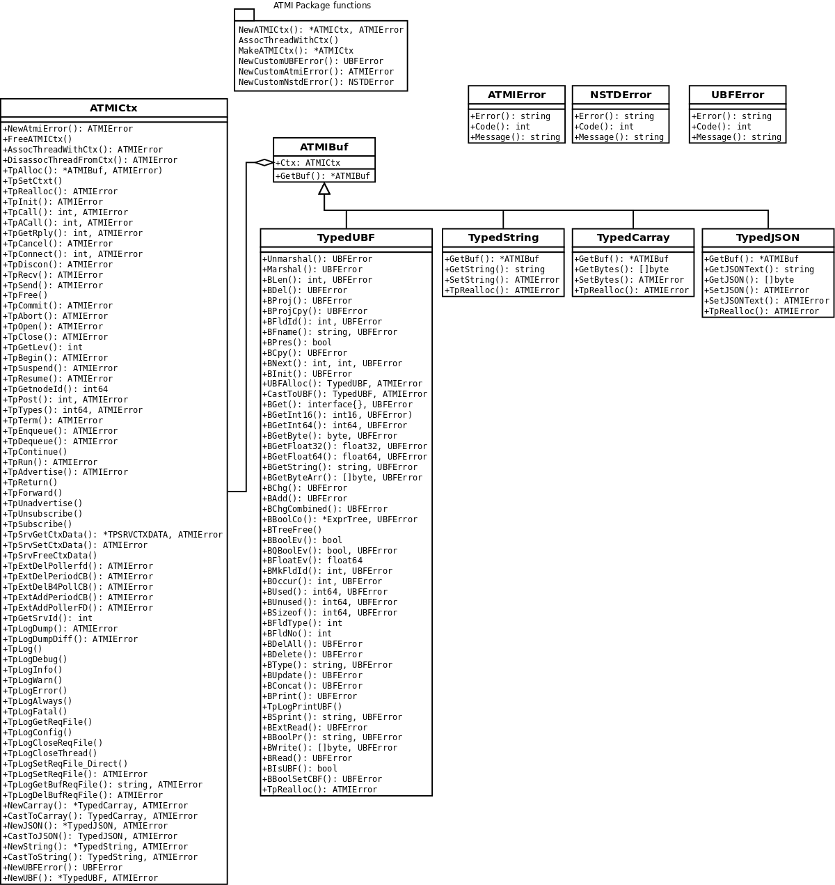

The book of the Enduro/X for Golang
===================================
Madars Vitolins
v1.0, 2016-11:
	Initial draft
:doctype: book

== Introduction

This module is set of objects that are bound to Enduro/X C based framework. 
Enduro/X by it self is middleware that uses operating system kernel queues for 
doing high performance inter-process communication. The middleware functionality 
is in the heart of the Enduro/X. Other functionality that comes in the package
is application server, which boots up the processes, monitors them (restarts is
they become dead), detects stalled services.

The processes in Enduro/X are split into to categories:

1. Client processes

2. Server processes

The client processes might be a stand alone process (executables running in system)
or it can be controlled by Enduro/X's Client Process Monitor (cpmsrv). Which gives
administrator nice interface for configuring/starting/stopping the clients.

The server processes are ones that are started by Enduro/X local daemon process
called 'ndrxd'. The server process have inside a thread which conforms the XATMI
server process workflow. At the startup the init function is called. Then threads
goes into waiting on message dispatches (waits on Posix queues). 

Once the application server is going for shutdown or administrator is about to
shutdown single server, then XATMI server process is notified of this action
and server process can gracefully do the de-init and shutdown. The uninit callback
is send to server process while doing shutdown.

== Installation on Linux operating system

To get started with endurox-go module, it is required to install

1. Go compiler and gcc compiler

2. PKG Config package (used by endurox-go) to resolve library dependencies

=== Installing Golang on Linux box

The process of installation should very similar on other operating systems too
(i.e. OSX, FreeBSD, etc.).

Select the Download package from here: https://golang.org/dl/

Enduro/X Go v9 requires Go 1.26 or newer and matching Enduro/X 9
development headers and libraries. The module import path is
`github.com/endurox-dev/endurox-go/v9`.

Particularity sample will run on amd64 on Linux OS:

--------------------------------------------------------------------------------
$ cd ~
$ wget https://golang.org/dl/go1.26.0.linux-amd64.tar.gz
$ sudo tar -C /usr/local -xzf go1.26.0.linux-amd64.tar.gz
$ echo "export PATH=\$PATH:/usr/local/go/bin" > $HOME/.profile
--------------------------------------------------------------------------------

=== Installing pkg config and C/C++ compiler (needed for CGO)

The PKG config is needed for endurox-go to select the needed dependences. The 
Enduro/X install the pkg config file named *atmisrvinteg.pc* to system's pkgconfig
path. This is later used by golang to build endurox-go. Golang needs pkgconfig package.

Installation process on Linux Ubuntu

--------------------------------------------------------------------------------
$ sudo apt-get install pkg-config gcc g++
--------------------------------------------------------------------------------

On RHEL Linux (if not already installed):

--------------------------------------------------------------------------------
$ su - root
# yum groupinstall 'Development Tools'
# yum install pkgconfig
--------------------------------------------------------------------------------

Installation on FreeBSD. Also we export PKG_CONFIG_PATH. And we switch the system
to the GNU make, otherwise tests does not compile.
--------------------------------------------------------------------------------
$ su - root
# pkg install pkgconf clang gmake
# mv /usr/bin/make /usr/bin/make.orig
# ln -s /usr/local/bin/gmake /usr/bin/make
$ exit
$ export PKG_CONFIG_PATH=$PKG_CONFIG_PATH:/usr/lib/pkgconfig
--------------------------------------------------------------------------------

Or for BSD, add the PKG_CONFIG_PATH path to /etc/profile.

== Installing Golang and using on AIX

IBM AIX only recently has added Golang compiler which works starting from AIX 7.2
running on POWER 8 and later CPUs. Also solution has some limitations,
one of which is that Go compiled binaries on AIX does not support runtime linkage 
which also prevents XA drivers to be loaded from shared libraries. 
Thus to have some transaction support in Go, only NULL switch
(libndrxxanulls.so) resolves to internal null switch driver, i.e. standard
configuration will work, but it is handled internally by Enduro/X that this particular
library resolves to statically linked NULL switch.

Golang request GCC compiler to be installed. It cannot be built with xlC as it
relies internally on GCC to perform CGO linkage. Thought runtime binaries does
not depend on GNU C/C++ libraries.

=== Installing Go, GCC and pkg-config

This assumes that Linux Toolbox is installed. If not installed, follow the instructions
on aix_notes(guides)(Building Enduro/X On IBM AIX Platform)

--------------------------------------------------------------------------------
$ su - root
# yum search gcc-cpp gcc-c++ golang pkg-config
--------------------------------------------------------------------------------

Set the PKG_CONFIG_PATH path:

--------------------------------------------------------------------------------
$ echo "export PKG_CONFIG_PATH=\$PKG_CONFIG_PATH:/usr/lib/pkgconfig" > $HOME/.profile
--------------------------------------------------------------------------------

=== Additional notes

When *building* binaries (only build time), ensure that following is set.

--------------------------------------------------------------------------------

$ export CC=gcc
$ export CXX=g++
$ export CFLAGS="-Wl,-brtl -maix64"

--------------------------------------------------------------------------------

As GCC otherwise would not be able to resolve freeware libraries. This also sets
the runtime linking flags, but these are not used by Go compiler (at-least in
version 1.16). But this particular CFLAGS value is needed if running "endurox-go/tests"
as view compiler builds Enduro/X binary for offset calculation and with out "-WL,brtl"
gcc does not seek for ".so" library files (which is default Enduro/X delivery
format).

== Trouble shooting

This section lists caveats found during Golang usage.

=== Golang compiler problems

go1.14 introduced use of *SIGURG* for internal purposes of the language runtime.
This causes Enduro/X Unix system calls to interrupt with *EINTR*, which can lead
to incorrect work of the binary using Enduro/X Go bindings.

The bug is reported here: https://github.com/golang/go/issues/50521

While this bug is not fixed, the Enduro/X Go binary shall be started with following
environment variable set:

--------------------------------------------------------------------------------

export GODEBUG="asyncpreemptoff=1"

--------------------------------------------------------------------------------

The setting may be applied to *app.ini* in *[@global]* section as:

--------------------------------------------------------------------------------

[@global]
...
GODEBUG=asyncpreemptoff=1

--------------------------------------------------------------------------------

=== AIX: Invalid GCC invocation from Golang for 64bit mode

If having error such as:

--------------------------------------------------------------------------------

go build && go install
# client
/opt/freeware/lib/golang/pkg/tool/aix_ppc64/link: gcc -Wl,-V failed: exit status 1
/usr/bin/ld: LD 7.2.4(2/13/18)
ld: 0711-738 ERROR: Input file /lib/crt0.o:
        XCOFF32 object files are not allowed in 64-bit mode.
collect2: error: ld returned 8 exit status

--------------------------------------------------------------------------------

Ensure that OBJECT_MODE is not set. As Go compiler at some moment invokes gcc
with out -maix64 flag for some AIX linker tests.

==== Memory leaks when using CGO

If Go code invokes user C code which uses Enduro/X Core API, memory may leak,
if contexting is not done properly. Enduro/X Core libraries require
certain Thread Local Storage (TLS) context, which Enduro/X Go API manages automatically.
By default native OS threads for Enduro/X Go binaries are not associated with
any such context and improper invocation of C code (e.g. via C. namespace), may trigger
Enduro/X Core to allocate new Context and depending on the scenario,
this may happen every time, when accessing such C code from Enduro/X Go code.

The proper way to make such invocations, would be to lock to OS thread (so that threads
does not swap between further calls) and associate it with Enduro/X ATMI context:

--------------------------------------------------------------------------------

func some_work(ac *atmi.ATMICtx) {

        runtime.LockOSThread()
        ac.AssocThreadWithCtx()
        
        C.invoke_c_func_which_does_atmi()

        ac.DisassocThreadFromCtx()
        runtime.UnlockOSThread()

        return
}

--------------------------------------------------------------------------------

The approach is the same as if using Distributed transactions, as described further
in the document, where thread association with context is required.

== API Model

The Enduro/X API object oriented where the main Enduro/X objects are held into Go
structures. List of methods are bound to the structures. Here is the main model
of the Go API:

== Enduro/X Go features

This section list the features which are supported by Go module.

- XATMI Server process

- XATMI Client process

- Distributed transaction processing (currently with patched go-oci8, which can 
be downloaded here: https://github.com/endurox-dev/go-oci8

- Debug logging infrastructure 

- Persistent queues

- Buffers: UBF, JSON, String, Binary array (carray)

- Load balancing

- High availability

== Version 9 APIs

The following methods belong to `ATMICtx`. They use the native object API
and return `ATMIError` on failure. Use each context and scripting VM
serially; use separate contexts for concurrent requests. Native flags and
field identifiers come from the installed Enduro/X 9 headers.

[cols="1,3",options="header"]
|===
| Area | Methods
| Saga and recovery
| `TpSagaEnlist`, `TpSagaEnd`, `TpSagaGet`, `TpSagaUpdate`, `TpSagaLeave`,
`TpTxStatus`, `TpTxRenew`, `TpXIDToString`, `TpXIDFromString`
| Multiple resource managers
| `TpOpen2`, `TpRMOpen`, `TpRMClose`, `TpRMStart`, `TpRMEnd`, `TpGetConnRM`
| Distributed lock manager
| `TpDLMMkCall`, `TpDLMCall`, `TpDLMACall`, `TpDLMConnect`,
`TpDLMToutGet`, `TpDLMAttemptsGet`
| Traces and context tags
| `TpTraceSpanBegin`, `TpTraceSpanEnd`, `TpTraceEvent`,
`TpTraceContextSet`, `TpTraceContextGet`, `TpTraceStateSet`,
`TpTraceStateGet`, `TpContextTagSet`, `TpContextTagClear`,
`TpContextTagClearAll`
| Embedded scripting
| `ATMICtx.TpScrInit`; `TpScrVm` methods `TpScrUninit`, `TpScrComp`,
`TpScrLoad`, `TpScrLoadStr`, `TpScrUnload`, `TpScrRegCB`, `TpScrUnregCB`,
`TpScrExec`, `TpScrError`, `TpScrErrno`, `TpScrSetError`;
`TpScrBytecode.TpScrFree`
| Buffer and event integration
| `TpBufCmp`, `TpExport` using native `tpexport2`, `TpExtGetReplyQFD`
|===

=== Saga transactions and recovery

A Saga is a pair of actions for work which is committed locally, outside of
the two-phase commit, for example a call to a web service. When the global
transaction commits, *tmsrv* calls the commit action, which confirms the work;
when it is rolled back or times out, *tmsrv* calls the rollback action, which
compensates it. See *tpsagaenlist(3)* for the full description.

A participant fills in a `TpSagaCtl`, registers it with `TpSagaEnlist` inside
the global transaction, does its local work and calls `TpSagaEnd`:

[source,go]
--------------------------------------------------------------------------------
var ctl atmi.TpSagaCtl
if err := ctl.SetSagaName("order"); nil != err {
    return err
}
if err := ctl.SetCommitURL("xatmi://ORDERCOMMIT"); nil != err {
    return err
}
if err := ctl.SetPayload([]byte("order-123")); nil != err {
    return err
}
if err := ctx.TpSagaEnlist(&ctl, 0); nil != err {
    return err
}
branch := ctl.GetBranchXID()
--------------------------------------------------------------------------------

The control types (`TpSagaCtl`, `TpTxStatus`, `TpDlmCtl`, `TpScrCfg`) are
used through getters and setters; a zero value is ready to use. A copy of an
initialized control shares its data with the original, so declare a new
variable for independent data. Setters return an error, and keep the old
value, when the value does not fit. `SetPayload` copies the bytes (at most
`NDRX_SAGA_PAYLOAD_MAX`, 4096) and `GetPayload` returns a copy.

After `TpSagaEnlist`, `GetBranchXID()` returns the branch identifier, which
identifies this participant in all its actions, also after a restart; store
it with the local work. `GetXID()` returns the global transaction identifier.
If the result of the registration is unknown, abort the transaction.

Callback URLs are given explicitly, and the `[@saga]` configuration must
allow them. An empty URL means that the action is not called; at least one of
commit, rollback or after is needed.

`TpSagaEnd` ends the local work; the participant stays registered. When the
Saga configuration has `dlmspace`, it also releases the Saga lock of the
Distributed Lock Manager (DLM) of the Enduro/X Enterprise Edition. In case
if `TPSAGA_NOLOCK` flag is set in `ctl.SetFlags`, `TpSagaEnd` shall not be called.
`TpSagaLeave` removes the participant, so its actions are not called.

Other methods (each takes the control and a separate `flags` argument):

* `TpSagaGet` reads the registered URLs and settings by `SetBranchXID`, also
  during recovery. It does not return the payload.
* `TpSagaUpdate` replaces the payload and URLs while the transaction is active.
  With `TPSAGA_URLSONLY` it replaces only the URLs, also while the transaction
  completes; read the current URLs with `TpSagaGet` first and keep the same
  actions present.
* Set a Saga key to make a repeated registration safe: the same key returns
  the Saga already registered. A key reused with different data fails, unless
  `TPSAGA_UPDATE` is given, which replaces the Saga's data.
* With `TPSAGA_JOINXID`, `TpSagaEnlist` registers in the transaction given by
  `ctl.SetXID`, without the caller being in it.
* `TpTxStatus` and `TpTxRenew` query a transaction and extend its timeout.
  Select the transaction with `SetFlags` and one of `TPTXS_XID` (`SetXID`),
  `TPTXS_BRXID` (`SetBranchXID`) or `TPTXS_TRANID` (`SetTranID` with a
  `TpSuspend` result, or `SetTranIDString`). `TpTxRenew` sets the deadline to
  `SetTimeout` seconds from now. Read the result with `GetStatus`,
  `GetTimeout` and `GetTimeoutLeft`. Their `flags` must be zero.

There are three distinct identifier representations:

* `XID` is an opaque native global identifier. `TpXIDToString` and
  `TpXIDFromString` use the native `TPCONVXID` conversion.
* `GetBranchXID()` returns the participant identifier after `TpSagaEnlist`.
* `TPTRANID` is the native suspend record. `GetTranIDString` and
  `SetTranIDString` use its Base64 representation, compatible with
  `TpSuspendString`. Its format depends on the runtime ABI; do not reuse v8
  tokens with v9.

These bindings provide the native Saga operations. A public native API
for completion by global XID is still needed before implementing the
restincl LRA coordinator close/cancel routes.

=== Resource managers, DLM, and utilities

`TpOpen2(flags)` accepts `TPTXOPENALL`. The `TpRMOpen`, `TpRMClose`,
`TpRMStart`, and `TpRMEnd` methods take a resource-manager name and flags.
`TpGetConnRM(rmid)` returns a borrowed native connection pointer; the
resource manager owns it.

`TpDlmCtl` exposes `Get/SetFlags`, `Get/SetDLMSpace`, `Get/SetSvcName` and
`Get/SetWaitTime`. `TpDLMMkCall(ub, ctl)` prepares a UBF request and updates
the native control; obtain its service name with `ctl.GetSvcName()`. It may replace the buffer. `TpDLMCall(svc, buf, flags)`
also updates the returned buffer and length. `TpDLMACall` and
`TpDLMConnect` return their descriptors. Check both transport errors and
per-command `EX_DLM_RVAL1` results: a successful call can contain a
command failure. The `NDRX_DLM_*`, `EX_DLM_*`, and shared `NE*` constants
are exported, including force deletion and regex unlock flags.

`TpDLMToutGet(waitTime)` returns effective milliseconds, per-attempt
milliseconds, per-attempt ATMI seconds, and an error.
`TpDLMAttemptsGet()` returns the configured limit, not attempts consumed.

`TpBufCmp(left, right, flags)` returns -1, 0, or 1 for a successful
comparison; only -2 means an error. Nil buffers represent native NULL.
`TpExport` retains its Go signature and returns dynamically sized JSON.
`TpExtGetReplyQFD` returns a borrowed pollable descriptor; do not close it.
Unsupported native queue backends return an error.

`TPQCTL.Traceparent` is output-only for enqueue/dequeue. Assigning it does
not select a parent. `TPQKEEPORIG` preserves the native origin metadata.
Queue control marshalling uses the native `CLIENTID` capacity including
its terminating NUL.

=== Tracing and context tags

`TpTraceContextSet/Get` exchange W3C traceparent strings and
`TpTraceStateSet/Get` exchange tracestate strings on an active span. Each takes call flags;
getters return a string and an error. `TpTraceSpanBegin(name, attrs,
flags)` returns a `TpTraceSpan` handle and an error. Pass it to
`TpTraceSpanEnd(span, status, attrs, flags)`. A span is valid only in the
context which started it. Attributes are optional
`*TypedUBF` buffers. `TpTraceEvent(name, attrs, flags)` records an event.

`TpContextTagSet(key, value, flags)`, `TpContextTagClear(key, flags)`, and
`TpContextTagClearAll(flags)` expose the `TPCTXTAG_*` scope and signal
flags. NEXT tags persist until explicitly cleared. Clear request-specific
trace context, state, and tags when reusing a context for another request.

=== Embedded scripting and ownership

An application can run scripts with typed buffers, in a similar way as it
calls services, and scripts can call Go functions. The interpreter comes from
a scripting plugin configured with *NDRX_PLUGINS*, for example the Python
plugin of the separately licensed *endurox-python*. See *tpscrinit(3)* for the
general rules.

`ac.TpScrInit(cfg, flags)` creates a VM (`*TpScrVm`); pass nil as `cfg` for
the plugin defaults. The VM belongs to the context `ac`: scripts run in its
transaction, and the VM is used from one goroutine at a time, like the
context. For parallel work, use one context and one VM per goroutine. No OS
thread locking is needed.

Load scripts with `vm.TpScrLoadStr(name, source, flags)`, or compile them once
with `vm.TpScrComp(source, flags)` and load the result with
`vm.TpScrLoad(name, code.Bytes(), flags)`; release compiled code with
`code.TpScrFree()`. `vm.TpScrUnload` removes a script. The load flags are
`NDRX_TPSCR_PACKAGE`, `NDRX_TPSCR_REPLACE` and `NDRX_TPSCR_FLAT`.

Run a script with `TpScrExec`, using ordinary typed buffers:

[source,go]
--------------------------------------------------------------------------------
func (vm *TpScrVm) TpScrExec(name string,
    param TypedBuffer, input TypedBuffer, flags int64) (TypedBuffer, ATMIError)

type TpScrCallback func(ctx *ATMICtx, vm *TpScrVm, name string,
    param TypedBuffer, input TypedBuffer, user interface{},
    flags int64) (TypedBuffer, ATMIError)
--------------------------------------------------------------------------------

Pass nil for a buffer which is not used. The script may resize the input
buffers; the binding updates them, also when an error is returned. The output
may be the input buffer itself; it is also returned with an error, if the
script gave one. Use `GetBuf()` and the usual typed-buffer casts on the output.

`vm.TpScrRegCB(name, callback, user, flags)` registers a Go function which
scripts can call; `vm.TpScrUnregCB` removes it. The callback receives the
context which owns the VM and the input buffers, valid only during the call.
It changes buffers with their usual methods, returns a typed buffer as output,
or returns an error to fail; `*TpScrError` also carries a script error code. A
callback may run another script of the same `vm`. A callback reached from a
script of a VM of another context fails with `TPEPROTO` without running.

Errors of the scripting methods may be `*TpScrError`, with both `ATMICode` and
`ScriptCode`. `vm.TpScrError()` and `vm.TpScrErrno()` return the script error
message and code; `vm.TpScrSetError(code, message)` sets them, for example in
a callback.

Close the VM with `vm.TpScrUninit(flags)`. `FreeATMICtx()` also closes the
open VMs and compiled code of the context, but does nothing while a VM of the
context runs, for example when it is called from a callback. A context with
open VMs is not garbage collected. Do not use a VM after closing it, even if
closing failed.

=== Binding regression checks

Integration cases are grouped by functional area under `tests/`. Each
case has its own configuration, client, Makefiles and launcher:

* `13_buffer_utils`: comparison ordering, dynamic export/import and
  transport-length selection.
* `14_saga`: real tmsrv registration, status/renewal, suspend/resume,
  participant updates/removal and commit/rollback callback ordering.
* `15_tracing`: context/state round trips, context isolation, spans,
  events, tags and propagation through an XATMI server.
* `16_scripting`: compiler output ownership, callbacks, buffer aliases,
  nested execution, errors and scripting in XATMI service dispatch.
* `17_dlm`: DLM server and Go proxy, SET/GET/DEL, asynchronous replies,
  conversational listing and timeout settings (explicit `-dlm`).
* `18_multi_rm`: two native resources, distinct connection handles, named
  open/close and manual enlistment in client/server transactions.

Build without running the cases:

--------------------------------------------------------------------------------
make -C tests
# Or build one functional area:
make -C tests/15_tracing
--------------------------------------------------------------------------------

From `tests/`, run `./run.sh` for the default suite or a case's `run.sh`
for that area. The default cases use core domains and do not require Enduro/X EE.
Use `./run.sh -dlm` to include the EE DLM case; `-dlm` and `-scripting`
can be supplied independently or together.
Fast scenarios run for 10 seconds by default (NDRX_TEST_DURATATION). Root `go test` does not run them.

Scripting is skipped by default, including direct invocation of its
launcher. It requires separately licensed `endurox-python`. Configure
that scripting plugin and Python environment, then opt in from `tests/`:

--------------------------------------------------------------------------------
./run.sh -scripting
# Or only scripting:
16_scripting/run.sh -scripting
--------------------------------------------------------------------------------

An explicitly enabled scripting case fails if its plugin is unavailable.
See each directory's README for coverage and domain settings. Each area
includes its own XATMI server. DLM tests also require EE `tpdlmsv` on PATH.
Crash recovery and queue trace propagation require additional scenarios.

== Constants
This chapter describes constants used by Enduro/X module. This includes error codes
and flags.

=== OR'able flags for different ATMI Object methods

*TPNOBLOCK* (0x00000001) - Do not block the operation (don't wait for reply or 
resource availability).

*TPSIGRSTRT* (0x00000002) - Restart the the system call if interrupted.

*TPNOREPLY* (0x00000004) - Make asynchronous call, do not wait for reply. 

*TPNOTRAN* (0x00000008) - Do not run in transaction mode.

*TPTRAN* (0x00000010) - Reserved for future use.

*TPNOTIME* (0x00000020) - Do not interrupt the call by timeout condition.

*TPGETANY* (0x00000080) - Get any call reply.

*TPNOCHANGE* (0x00000100) - Do not change buffer format. If reply on tpcall()
receives other buffer format than specified in call and this flag is set, then
error will be generated.

*TPCONV* (0x00000400) - Reserved for future use.

*TPSENDONLY* (0x00000800) - Enter in sending mode during conversational IPC.

*TPRECVONLY* (0x00001000) - Enter in receiving mode during conversational IPC.

*TPTRANSUSPEND* (0x00040000) - Suspend current transaction.

*TPSOFTTIMEOUT* (0x00080000) - Soft timout condition -> ret TPETIME, used for TpReturn()

*TPSOFTENOENT* (0x00100000) - Simulate that service is not found, used for TpReturn()

*TPNOAUTBUF* (0x00200000) - Don't restore autbuf in srv context, used for TpSrvSetCtxData()

=== ATMI buffer size
Current Enduro/X version support maximum buffer size of 64KB. The constant is
defined for that:

*ATMI_MSG_MAX_SIZE* (65536) - Max ATMI message size.

This is subject of change in future. It might that dynamic number (configurable)
will be available.

=== ATMI Error codes (returned by ATMIError interface)

This chapter lists the error codes returned by ATMI calls.

*TPMINVAL* (0) - No error.

*TPEABORT* (1) - Transaction was marked for abort.

*TPEBADDESC* (2) - Bad call descriptor.

*TPEBLOCK* (3) - Reserved for future use.

*TPEINVAL* (4) - Invalid value passed to function.

*TPELIMIT* (5) - System limits exceeded (max queues or call descriptors open).

*TPENOENT* (6) - No Entry (XATMI service or other resources).

*TPEOS* (7) - Operating system error occurred.

*TPEPERM* (8) - Reserved for future use.

*TPEPROTO* (9) - Protocol error. Invocation of XATMI functions in invalid order.

*TPESVCERR* (10) - Server error. XATMI server died during processing.

*TPESVCFAIL* (11) - Application level error at service.

*TPESYSTEM* (12) - System error.

*TPETIME* (13) - Time-out condition.

*TPETRAN* (14) - Transaction error.

*TPGOTSIG* (15) - Reserved for future use.

*TPERMERR* (16) - Resource manager error (used for distributed transactions processing)

*TPEITYPE* (17) - Reserved for future use. 

*TPEOTYPE* (18) - Invalid output type.

*TPERELEASE* (19) - Reserved for future use. 

*TPEHAZARD* (20) - Hazardous condition occurred. Transaction is partially 
committed and/or abort.

*TPEHEURISTIC* (21) - Heuristic condition occurred. Transaction is partially 
committed and/or abort.

*TPEEVENT* (22) - Event notification received for conversational IPC session.

*TPEMATCH* (23) - Did not match given identifier.

*TPEDIAGNOSTIC* (24) - Additional information is returned in diagnostics field 
(used by persistent queues API).

*TPEMIB* (25) - Reserved for future use. 

*TPINITFAIL* (30) - Reserved for future use. 

*TPMAXVAL* (31) - Maximum error code.

=== Return values for tpcall()/tpreturn()

Values for rval in tpreturn:

*TPFAIL* (0x0001) - Application level error occurred, returns tpcall() gives *TPESVCFAIL*
as error.

*TPSUCCESS* (0x0002) - Service succeeded.

=== Flags Persistent queue functions, used for TPQCTL.flags

*TPNOFLAGS* (0x00000) - No flags used.

*TPQCORRID* (0x00001) - Set/get correlation id (on set TPQCTL.corrid must
be specified.

*TPQFAILUREQ* (0x00002) - Set/get failure queue. On set TPQCTL.failurequeue must
be specified.

*TPQBEFOREMSGID* (0x00004) - RFU, enqueue before message id.

*TPQGETBYMSGIDOLD* (0x00008) - RFU, deprecated.

*TPQMSGID* (0x00010) - Get msgid of enqueued/dequeued message.

*TPQPRIORITY* (0x00020) - Set/get message priority.

*TPQTOP* (0x00040) - RFU, enqueue at queue top.

*TPQWAIT* (0x00080) - RFU, wait for dequeuing.

*TPQREPLYQ* (0x00100) - Set/get reply queue.

*TPQTIME_ABS* (0x00200) - RFU, set absolute time.

*TPQTIME_REL* (0x00400) - RFU, set absolute time.

*TPQGETBYCORRIDOLD* (0x00800) - RFU.

*TPQPEEK* (0x01000) - Peek the message from queue. Do not dequeue it permanently.

*TPQDELIVERYQOS* (0x02000) - RFU, delivery quality of service.

*TPQREPLYQOS* (0x04000) -  RFU, reply message quality of service.

*TPQEXPTIME_ABS* (0x08000) -  RFU, absolute expiration time.

*TPQEXPTIME_REL* (0x10000) -  RFU, relative expiration time.

*TPQEXPTIME_NONE* (0x20000) -  RFU, never expire.

*TPQGETBYMSGID* (0x40008) -  Dequeue by msgid.

*TPQGETBYCORRID* (0x80800) - Dequeue by corrid.

*TPQASYNC* (0x100000) - Async complete. Complete the disk based transaction asynchronously.

=== Other persistent queue sub-system constants

*TMMSGIDLEN* (32) - Message id (number of bytes). All bytes significant.

*TMCORRIDLEN* (32) - Correlator id (number of bytes). All bytes significant.

*TMQNAMELEN* (15) - Max queue name length.

*NDRX_MAX_ID_SIZE* (96) - Client ID length
	

=== Diagnostic codes for persistent queues

For persistent queue sub-system which are used by TpEnqueue(3) and TpDequeue(3)
there are special control structure used named *TPQCTL* it contains field 
*TPQCTL.diagnostic* which return diagnostic code. This field is filled in case if
*ATMIError.Code()* is set to TPEDIAGNOSTIC. Note that additional error message is
provided into *TPQCTL.diagmsg*

*QMEINVAL* (-1) - Invalid value passed to function.

*QMEBADRMID* (-2) - RFU.

*QMENOTOPEN* (-3) - RFU.

*QMETRAN* (-4) - RFU.

*QMEBADMSGID* (-5) - RFU.

*QMESYSTEM* (-6) - System error occurred. More info in logs.

*QMEOS* (-7) - Operating system error occurred. More info in logs.

*QMEABORTED* (-8) - RFU.

*QMENOTA* (-8) - RFU.

*QMEPROTO* (-9) - RFU.

*QMEBADQUEUE* (-10) - RFU.

*QMENOMSG* (-11) - No message found.

*QMEINUSE* (-12) - RFU.

*QMENOSPACE* (-13) - RFU.

*QMERELEASE* (-14) - RFU.

*QMEINVHANDLE* (-15) - RFU.

*QMESHARE* (-16) - RFU.

=== Enduro/X standard library error codes
List of error codes that can be returned by NSTDError interface:

*NEINVALINI* (1) - Invalid INI file

*NEMALLOC* (2) - Malloc failed 

*NEUNIX* (3) - Unix error occurred

*NEINVAL* (4) - Invalid value passed to function

*NESYSTEM* (5) - System failure

*NEMANDATORY* (6) - Mandatory field is missing

*NEFORMAT* (7) - Format error 

=== Unified Buffer Format (UBF) library error codes

These error codes are returned by UBFError interface:

*BMINVAL* (0) - No error.

*BERFU0* (1) - Reserved for future use.

*BALIGNERR* (2) - Invalid UBF buffer.

*BNOTFLD* (3) - Buffer not fielded/invalid UBF buffer.

*BNOSPACE* (4) - No space in buffer left.

*BNOTPRES* (5) - Field not present.

*BBADFLD* (6) - Bad field id.

*BTYPERR* (7) - Invalid field type.

*BEUNIX* (8) - Unix error.

*BBADNAME* (9) - Bad field name.

*BMALLOC* (10) - Malloc failed.

*BSYNTAX* (11) - Syntax error for boolean expression.

*BFTOPEN* (12) - Failed to open field table (ubftab).

*BFTSYNTAX* (13) - Field table (ubftab) syntax error.

*BEINVAL* (14) - Invalid value passed to function.

*BERFU1* (15) - Reserved for future use.

*BERFU2* (16) - Reserved for future use.

*BERFU3* (17) - Reserved for future use.

*BERFU4* (18) - Reserved for future use.

*BERFU5* (19) - Reserved for future use.

*BERFU6* (20) - Reserved for future use.

*BERFU7* (21) - Reserved for future use.

*BERFU8* (22) - Reserved for future use.

*BMAXVAL* (22) - Maximum error code;

=== UBF field types

This chapter lists field types (C level) used by UBF:

*BFLD_MIN* (0) - Minimum field type

*BFLD_SHORT* (0) - C Short type

*BFLD_LONG* (1) -C Long type

*BFLD_CHAR* (2) - C Chart type (single byte)

*BFLD_FLOAT* (3) - C Float type

*BFLD_DOUBLE* (4) - C Double type

*BFLD_STRING* (5) - String type

*BFLD_CARRAY* (6) - Byte array type

*BFLD_MAX* (6) - Maximum field type

=== UBF reserved field IDs

*BBADFLDID* (0) - Bad field id, used as terminator Bproj() and other calls.

*BFIRSTFLDID* (0) - First field id, used indicator for Bnext() to iterate through
the buffer.

=== Log levels
Enduro/X provides logging API (see ATMICtx.TpLog() and related functions).
Following debug levels are supported:

*LOG_ALWAYS* (1) - Fatal error. Logs always.

*LOG_ERROR* (2) - Error message.

*LOG_WARN* (3) - Warning message.

*LOG_INFO* (4) - informational message.

*LOG_DEBUG* (5) - Debug message.

*LOG_DUMP* (6) - Very detailed debug with full dumps.

=== Log Facilities

Enduro/X logging can be configured for different logging sources which includes
Enduro/X debugging it self (provides separation for base ATMI (*NDRX*), Unified 
Buffer Format (*UBF*) functions). The user logging are configured under the *TP* facility.

User logging can be associated in following levels:

- Per process;

- Per thread (for Go it is Context).

- Per request (associate with Context, i.e. if thread logging enabled, then it can be
promoted to request logging by *ATMICtx.TpLogSetReqFile()*).

*LOG_FACILITY_NDRX* (0x00001) - Settings for ATMI logging.

*LOG_FACILITY_UBF* (0x00002) - Settings for UBF logging.

*LOG_FACILITY_TP* (0x00004) - Settings for TP logging.

*LOG_FACILITY_TP_THREAD* (0x00008) - Settings for TP, thread based logging.

*LOG_FACILITY_TP_REQUEST* (0x00010) - Request logging, thread based.

== Structures

This section lists the exported (public) structures provided by Endurox-Go module.

[cols="h,5a",options="header"]
|===
|Struct/interface
|Description

|TPTRANID
|Transaction identifier

|ATMICtx
|ATMI Context object

|TPSRVCTXDATA
|Server Context data used for copying request context from one Context to another

|TPEVCTL
|Event control structure (see bellow for more information)

|TPQCTL
|Queue control structure (see bellow for more information)

|ATMIBuf
|ATMI buffer object (abstract one)

|TypedBuffer
|Interface to ATMIBuf. Provides getter for getting raw buffer handler

|TypedUBF
|Interface to UBF buffer.

|TypedCarray
|Interface to byte array buffer.

|TypedString
|Interface to String buffer.

|TypedJSON
|Interface to JSON buffer.

|ATMIError
|ATMI Error interface. Provides Error(), Code(), Message() methods.

|UBFError
|UBF library error interface. Provides Error(), Code(), Message() methods.

|NSTDError
|Stndard library error interface. Provides Error(), Code(), Message() methods.

|TPSVCINFO
|XATMI service call descriptor, provided to called service as parameters.
(see bellow for more information)
|===

=== Event control structure - TPEVCTL

--------------------------------------------------------------------------------
/*
 * Event controll struct
 */
type TPEVCTL struct {
	flags int64
	name1 string
	name2 string
}
--------------------------------------------------------------------------------

TPEVCTL is used by ATMICtx.TpSubscribe() function. TPEVCTL structure contains following fields:

- *flags* int64 - can be set to: TPEVSERVICE, TPEVPERSIST

- *name1* string - Event expression

- *name2* string - RFU.

See tpsubscribe(3) C manpage.

=== Queue operations control structure - TPQCTL

Queue control structure is self explanatory.

--------------------------------------------------------------------------------
/*
 * Queue control structure
 */
type TPQCTL struct {
	flags        int64             /* indicates which of the values are set */
	deq_time     int64             /* RFU, absolute/relative  time for dequeuing */
	priority     int64             /* RFU, enqueue priority */
	diagnostic   int64             /* indicates reason for failure */
	diagmsg      string            /* diagnostic message */
	msgid        [TMMSGIDLEN]byte  /* id of message before which to queue */
	corrid       [TMCORRIDLEN]byte /* correlation id used to identify message */
	replyqueue   string            /* queue name for reply message */
	failurequeue string            /* queue name for failure message */
	cltid        string            /* client identifier for originating client */
	urcode       int64             /* RFU, application user-return code */
	appkey       int64             /* RFU, application authentication client key */
	delivery_qos int64             /* RFU, delivery quality of service  */
	reply_qos    int64             /* RFU, reply message quality of service  */
	exp_time     int64             /* RFU, expiration time  */
}
--------------------------------------------------------------------------------

=== Incoming service call information structure - TPSVCINFO
When XATMI server receives request, it receives a control structure with information
about sender and meta data about service which actually is invoked. For example:

--------------------------------------------------------------------------------

package main

import (
        "atmi"
        "fmt"
        "os"
)

//Service func
//Here svc contains the caller infos
func TESTSVC(ac *atmi.ATMICtx, svc *atmi.TPSVCINFO) {

        ac.TpReturn(atmi.TPSUCCESS, 0, &ub, 0)

}

//Server boot/init
func Init(ac *atmi.ATMICtx) int {

        //Advertize TESTSVC
        if err := ac.TpAdvertise("TESTSVC", "TESTSVC", TESTSVC); err != nil {
                fmt.Println(err)
                return atmi.FAIL
        }

        return atmi.SUCCEED
}

//Server shutdown
func Uninit(ac *atmi.ATMICtx) {
        fmt.Println("Server shutting down...")
}

//Server main
func main() {
        //Have some context
        ac, err := atmi.NewATMICtx()

        if nil != err {
                fmt.Errorf("Failed to allocate cotnext!", err)
                os.Exit(atmi.FAIL)
        } else {
                //Run as server
                ac.TpRun(Init, Uninit)
        }
}

--------------------------------------------------------------------------------

TPSVCINFO is defined as follows (with explanatory comments):

--------------------------------------------------------------------------------
//Servic call info
type TPSVCINFO struct {
	Name   string   /* Service name */
	Data   ATMIBuf  /* Buffer type */
	Flags  int64    /* Flags used for service invation */
	Cd     int      /* Call descriptor (generated by client) */
	Cltid  string   /* Client ID string - full client queue name */
	Appkey int64    /* RFU */
	Fname  string   /* Function name invoked (set at TpAdvertise second param) */
	Ctx    *ATMICtx /* ATMI Server Context */
}
--------------------------------------------------------------------------------

The TPSVCINFO.Ctx basically is the same context passed into service function as
first argument.

== API

Section lists API functions in following levels:

- ATMI package (global functions)

- ATMI Context functions

- ATMI Error functions

- UBF functions

[[gen_doc-start]]
=== ATMI Package functions
Enduro/X package functions. ATMI Context is initiated by this package.

==== atmi.ATMIMsgSizeMax()
[cols="h,5a"]
|===
|Function
|func ATMIMsgSizeMax() int64
|Description
|Max message size.
|Returns
|buffer size configured by Enduro/X, min 64K
|Applies
|XATMI client and server
|===

==== atmi.ExSizeOfLong()
[cols="h,5a"]
|===
|Function
|func ExSizeOfLong() int
|Description
|Return size of long. Used to detect running platform Basically all int64 APIs
used by ATMI package will resolve from Enduro/X point of view this count of
bytes..
|Returns
|number of bytes in "long" data type
|Applies
|XATMI client and server
|===

==== atmi.MakeATMICtx()
[cols="h,5a"]
|===
|Function
|func MakeATMICtx(c_ctx C.TPCONTEXT_T) *ATMICtx
|Description
|Make context object from C pointer. Function can be used in case If doing any
direct XATMI operations and you have a C context handler. Which can be promoted
to Go level ATMI Context..
*c_ctx* is Context ATMI object.
|Returns
|ATMI Context Object
|Applies
|XATMI client and server
|===

==== atmi.NewATMICtx()
[cols="h,5a"]
|===
|Function
|func NewATMICtx() (*ATMICtx, ATMIError)
|Description
|Allocate new ATMI context. This is the context with most of the XATMI
operations are made. Single go routine can have multiple contexts at the same
time. The function does not open queues or init XATMI sub-system unless the
dependant operation is called. For example you may allocat the context and use
it for logging that will not make overhead for system queues..
|Returns
|ATMI Error, Pointer to ATMI Context object
|Applies
|XATMI client and server
|===

==== atmi.NewCustomATMIError()
[cols="h,5a"]
|===
|Function
|func NewCustomATMIError(code int, msg string) ATMIError
|Description
|Build a custom error.
*err* is Error buffer to build.
*code* is Error code to setup.
*msg* is Error message.
|Applies
|XATMI client and server
|===

==== atmi.NewCustomNstdError()
[cols="h,5a"]
|===
|Function
|func NewCustomNstdError(code int, msg string) NSTDError
|Description
|Build a custom error. Can be used at Go level sources To simulate standard
error.
*err* is Error buffer to build.
*code* is Error code to setup.
*msg* is Error message.
|Applies
|XATMI client and server
|===

==== atmi.NewCustomUBFError()
[cols="h,5a"]
|===
|Function
|func NewCustomUBFError(code int, msg string) UBFError
|Description
|Build a custom error.
*err* is Error buffer to build.
*code* is Error code to setup.
*msg* is Error message.
|Applies
|XATMI client and server
|===

==== atmi.RuntimeInit()
[cols="h,5a"]
|===
|Function
|func RuntimeInit()
|Description
|Sets the common runtime for the Enduro/X Go binaires As of Go 1.14, it sends
SIGURG for preemption to process GC - but this breaks C runtime. Official
option is to set env variable GODEBUG="asyncpreemptoff=1" However, for
convenience, function is provided to ignore SIGUR signals, thus they shall
never reach the C code. This solution however is experimental, and is subject
of changes for future module versions. In the current implementation, if
"asyncpreemptoff" setting in GODEBUG env is found, function does not perform
changes for signal handling (thus, logic may be disabled at runtime, if
needed)..
|Applies
|XATMI client and server
|===

=== Enduro/X Standard Error Object / NSTDError interface
Enduro/X standard error object interfaced with NSTDError interface. Error is returned
by libnstd library. Which are Enduro/X base library. Currently it is used for logging.

==== nstdError.Code()
[cols="h,5a"]
|===
|Function
|func (e nstdError) Code() int
|Description
|Error code getter.
|Applies
|XATMI client and server
|===

==== nstdError.Error()
[cols="h,5a"]
|===
|Function
|func (e nstdError) Error() string
|Description
|Standard error interface.
|Applies
|XATMI client and server
|===

==== nstdError.Message()
[cols="h,5a"]
|===
|Function
|func (e nstdError) Message() string
|Description
|Error message getter.
|Applies
|XATMI client and server
|===

=== ATMI Error object / ATMIError interface
ATMI Error object, used for ATMI context functions. Error codes are described in
seperate chapter in this document.

==== atmiError.Code()
[cols="h,5a"]
|===
|Function
|func (e atmiError) Code() int
|Description
|code getter.
|Applies
|XATMI client and server
|===

==== atmiError.Error()
[cols="h,5a"]
|===
|Function
|func (e atmiError) Error() string
|Description
|Standard error interface.
|Applies
|XATMI client and server
|===

==== atmiError.Message()
[cols="h,5a"]
|===
|Function
|func (e atmiError) Message() string
|Description
|message getter.
|Applies
|XATMI client and server
|===

=== Abstract IPC buffer - ATMIUbf
ATMI buffer is base class for String, JSON, UBF (key/value with value arrays)
and binary buffer.

==== ATMIBuf.GetBuf()
[cols="h,5a"]
|===
|Function
|func (u *ATMIBuf) GetBuf() *ATMIBuf
|Description
|Have inteface to base ATMI buffer.
|Applies
|XATMI client and server
|===

==== ATMIBuf.Len()
[cols="h,5a"]
|===
|Function
|func (buf *ATMIBuf) Len() int64
|Description
|Len returns the buffer's current transport length..
|Returns
|Current transport length in bytes; 0 for a nil buffer
|Applies
|XATMI client and server
|===

==== ATMIBuf.SetLen()
[cols="h,5a"]
|===
|Function
|func (buf *ATMIBuf) SetLen(length int64) ATMIError
|Description
|SetLen selects the data length within the existing allocation.  It does not
resize the buffer; zero is valid for self-describing buffers..
*length* is Nonnegative transport length within the existing allocation; 0
is valid for self-describing buffers.
|Returns
|Nil on success, otherwise ATMIError; the allocation is not resized
|Applies
|XATMI client and server
|===

==== ATMIBuf.TpRealloc()
[cols="h,5a"]
|===
|Function
|func (buf *ATMIBuf) TpRealloc(size int64) ATMIError
|Description
|Reallocate the buffer.
*size* is Requested allocation size in bytes.
|Returns
|Nil on success, otherwise ATMIError; failure preserves the original buffer
|Applies
|XATMI client and server
|===

==== ATMIBuf.TpSetCtxt()
[cols="h,5a"]
|===
|Function
|func (buf *ATMIBuf) TpSetCtxt(ac *ATMICtx)
|Description
|Change the context of the buffers (needed for error handling).
|Applies
|XATMI client and server
|===

==== ATMIBuf.TpTypes()
[cols="h,5a"]
|===
|Function
|func (ptr *ATMIBuf) TpTypes(itype *string, subtype *string) (int64, ATMIError)
|Description
|Return ATMI buffer info.
*itype* is ptr to string to return the buffer type  (can be nil), if set then
on output value will be UBF, CARRAY, STRING or JSON other buffers currently are
not supported..
*subtype* is ptr to string to return sub-type (can be nil).
|Returns
|Buffer lenght if no error or -1 if error, ATMI error
|Applies
|XATMI client and server
|===

=== ATMI Context
ATMI Context is uses as main object for accessing Enduro/X functionality. The
object is allocated by package function *atmi.NewATMICtx()*. ATMI Context API is
used for client and server API.

==== ATMICtx.AssocThreadWithCtx()
[cols="h,5a"]
|===
|Function
|func (ac *ATMICtx) AssocThreadWithCtx() ATMIError
|Description
|Associate current OS thread with context This might be needed for global
transaction processing Which uses underlaying OS threads for transaction
association.
|Applies
|XATMI client and server
|===

==== ATMICtx.BBoolCo()
[cols="h,5a"]
|===
|Function
|func (ac *ATMICtx) BBoolCo(expr string) (*ExprTree, UBFError)
|Description
|Compile boolean expression TODO: might want auto finalizer with Btreefree!.
*expr* is Expression string.
|Returns
|Expression tree (ptr or nil on error), UBF error
|Applies
|XATMI client and server
|===

==== ATMICtx.BBoolPr()
[cols="h,5a"]
|===
|Function
|func (ac *ATMICtx) BBoolPr(tree *ExprTree) (string, UBFError)
|Description
|Print the expression tree.
*tree* is Compiled expression tree.
|Returns
|printed expresion string, ubf error
|Applies
|XATMI client and server
|===

==== ATMICtx.BBoolSetCBF()
[cols="h,5a"]
|===
|Function
|func (ac *ATMICtx) BBoolSetCBF(funcname string, f UBFExprFunc) UBFError
|Description
|Set custom callback function for UBF buffer expression evaluator.
*funcname* is Name of the function to be used in expression.
*f* is callback to function.
|Returns
|UBF error
|Applies
|XATMI client and server
|===

==== ATMICtx.BConcat()
[cols="h,5a"]
|===
|Function
|func (ac *ATMICtx) BConcat(dest *TypedUBF, src *TypedUBF) UBFError
|Description
|Contact the buffers.
*dest* is dest buffer.
*src* is source buffer.
|Returns
|UBF error
|Applies
|XATMI client and server
|===

==== ATMICtx.BCpy()
[cols="h,5a"]
|===
|Function
|func (ac *ATMICtx) BCpy(dest *TypedUBF, src *TypedUBF) UBFError
|Description
|Copy buffer.
*dest* is Destination UBF buffer.
*src* is Source UBF buffer.
|Returns
|UBF error
|Applies
|XATMI client and server
|===

==== ATMICtx.BFldId()
[cols="h,5a"]
|===
|Function
|func (ac *ATMICtx) BFldId(fldnm string) (int, UBFError)
|Description
|Return field ID.
*fldnm* is Field name.
|Returns
|Field ID, UBF error
|Applies
|XATMI client and server
|===

==== ATMICtx.BFldNo()
[cols="h,5a"]
|===
|Function
|func (ac *ATMICtx) BFldNo(bfldid int) int
|Description
|Return field number.
*bfldid* is field id.
|Returns
|field number
|Applies
|XATMI client and server
|===

==== ATMICtx.BFldType()
[cols="h,5a"]
|===
|Function
|func (ac *ATMICtx) BFldType(bfldid int) int
|Description
|Return the field type.
*bfldid* is field id.
|Returns
|field type
|Applies
|XATMI client and server
|===

==== ATMICtx.BFname()
[cols="h,5a"]
|===
|Function
|func (ac *ATMICtx) BFname(bfldid int) (string, UBFError)
|Description
|Get field name.
*bfldid* is Field ID.
|Returns
|Field name (or "" if error), UBF error
|Applies
|XATMI client and server
|===

==== ATMICtx.BInit()
[cols="h,5a"]
|===
|Function
|func (ac *ATMICtx) BInit(u *TypedUBF, ulen int64) UBFError
|Description
|Initialize/re-initialize UBF buffer.
*u* is UBF buffer.
*ulen* is lenght of the buffer.
|Returns
|UBF error
|Applies
|XATMI client and server
|===

==== ATMICtx.BMkFldId()
[cols="h,5a"]
|===
|Function
|func (ac *ATMICtx) BMkFldId(fldtype int, bfldid int) (int, UBFError)
|Description
|Generate Field ID.
*fldtype* is Field type (see BFLD_SHORT cost list).
*bfldid* is field number.
|Returns
|field id or 0 if error, UBF error
|Applies
|XATMI client and server
|===

==== ATMICtx.BProjCpy()
[cols="h,5a"]
|===
|Function
|func (ac *ATMICtx) BProjCpy(dest *TypedUBF, src *TypedUBF, fldlist []int)
UBFError
|Description
|Make a project copy of the fields (leave only those in array) The terminator
in the fildlist array are not required. The list shall contain fields only to
copy. See *Bprojcpy(3)* for more details. NOTE! The dest buffer is erased
before copying new data to.
*dest* is is destination buffer.
*src* is is source buffer to copy from.
*fldlist* is list of fields to copy.
|Returns
|UBF error
|Applies
|XATMI client and server
|===

==== ATMICtx.BTreeFree()
[cols="h,5a"]
|===
|Function
|func (ac *ATMICtx) BTreeFree(tree *ExprTree)
|Description
|Free the expression buffer.
|Applies
|XATMI client and server
|===

==== ATMICtx.BUpdate()
[cols="h,5a"]
|===
|Function
|func (ac *ATMICtx) BUpdate(dest *TypedUBF, src *TypedUBF) UBFError
|Description
|Update dest buffer with source buffer data.
*dest* is dest buffer.
*src* is source buffer.
|Returns
|UBF error
|Applies
|XATMI client and server
|===

==== ATMICtx.BVSizeof()
[cols="h,5a"]
|===
|Function
|func (ac *ATMICtx) BVSizeof(view string) (int64, UBFError)
|Description
|Get structure size in bytes. See Bvsizeof(3)..
*view* is View name.
|Returns
|ret (number of view bytes (if no error)), UBFError in case of error
|Applies
|XATMI client and server
|===

==== ATMICtx.CastToCarray()
[cols="h,5a"]
|===
|Function
|func (ac *ATMICtx) CastToCarray(abuf *ATMIBuf) (*TypedCarray, ATMIError)
|Description
|Get the String Handler.
|Applies
|XATMI client and server
|===

==== ATMICtx.CastToJSON()
[cols="h,5a"]
|===
|Function
|func (ac *ATMICtx) CastToJSON(abuf *ATMIBuf) (*TypedJSON, ATMIError)
|Description
|Get the JSON Handler from ATMI Buffer.
|Applies
|XATMI client and server
|===

==== ATMICtx.CastToString()
[cols="h,5a"]
|===
|Function
|func (ac *ATMICtx) CastToString(abuf *ATMIBuf) (*TypedString, ATMIError)
|Description
|Get the String Handler from ATMI Buffer.
|Applies
|XATMI client and server
|===

==== ATMICtx.CastToUBF()
[cols="h,5a"]
|===
|Function
|func (ac *ATMICtx) CastToUBF(abuf *ATMIBuf) (*TypedUBF, ATMIError)
|Description
|Get the UBF Handler.
|Applies
|XATMI client and server
|===

==== ATMICtx.CastToVIEW()
[cols="h,5a"]
|===
|Function
|func (ac *ATMICtx) CastToVIEW(abuf *ATMIBuf) (*TypedVIEW, ATMIError)
|Description
|Get the view buffer handler. Usually used by service functions when request is
received..
*abuf* is ATMI buffer.
|Returns
|Typed view (if OK), nil on error. ATMI error in case of error or nil
|Applies
|XATMI client and server
|===

==== ATMICtx.DisassocThreadFromCtx()
[cols="h,5a"]
|===
|Function
|func (ac *ATMICtx) DisassocThreadFromCtx() ATMIError
|Description
|Disassocate current os thread from context This might be needed for global
transaction processing Which uses underlaying OS threads for transaction
association.
|Applies
|XATMI client and server
|===

==== ATMICtx.FreeATMICtx()
[cols="h,5a"]
|===
|Function
|func (ac *ATMICtx) FreeATMICtx()
|Description
|Free up the ATMI Context Internally this will call the TpTerm too to termiante
any XATMI client session in progress. Open scripting VMs and compiler outputs
of the context are released first. While a VM of the context is executing (e.g.
when called from its scripting callback) nothing is released: the request is
logged and ignored, and the context stays usable. If compiler output cannot be
released, the context also stays usable, so that TpScrFree can be retried.
While the resources are released (e.g. from a VM shutdown callback), new VMs
and compiler outputs cannot be created on the context..
|Applies
|XATMI client and server
|===

==== ATMICtx.NewATMIError()
[cols="h,5a"]
|===
|Function
|func (ac *ATMICtx) NewATMIError() ATMIError
|Description
|Generate ATMI error, read the codes.
|Applies
|XATMI client and server
|===

==== ATMICtx.NewCarray()
[cols="h,5a"]
|===
|Function
|func (ac *ATMICtx) NewCarray(b []byte) (*TypedCarray, ATMIError)
|Description
|Allocate new string buffer.
*s* is - source string.
|Applies
|XATMI client and server
|===

==== ATMICtx.NewJSON()
[cols="h,5a"]
|===
|Function
|func (ac *ATMICtx) NewJSON(b []byte) (*TypedJSON, ATMIError)
|Description
|Allocate new JSON buffer.
*s* is - source string.
|Applies
|XATMI client and server
|===

==== ATMICtx.NewNstdError()
[cols="h,5a"]
|===
|Function
|func (ac *ATMICtx) NewNstdError() NSTDError
|Description
|Generate NSTD error, read the codes.
|Applies
|XATMI client and server
|===

==== ATMICtx.NewString()
[cols="h,5a"]
|===
|Function
|func (ac *ATMICtx) NewString(gs string) (*TypedString, ATMIError)
|Description
|Allocate new string buffer.
*s* is - source string.
|Applies
|XATMI client and server
|===

==== ATMICtx.NewUBF()
[cols="h,5a"]
|===
|Function
|func (ac *ATMICtx) NewUBF(size int64) (*TypedUBF, ATMIError)
|Description
|Allocate the new UBF buffer NOTE: realloc or other ATMI ops you can do with
TypedUBF.Buf.
*size* is - buffer size.
|Returns
|Typed UBF, ATMI error
|Applies
|XATMI client and server
|===

==== ATMICtx.NewUBFError()
[cols="h,5a"]
|===
|Function
|func (ac *ATMICtx) NewUBFError() UBFError
|Description
|Generate UBF error, read the codes.
|Applies
|XATMI client and server
|===

==== ATMICtx.NewVIEW()
[cols="h,5a"]
|===
|Function
|func (ac *ATMICtx) NewVIEW(view string, size int64) (*TypedVIEW, ATMIError)
|Description
|Allocate the new VIEW buffer.
*size* is - buffer size, If use 0, then 1024 or bigger view size is allocated..

|Returns
|TypedVIEW, ATMI error
|Applies
|XATMI client and server
|===

==== ATMICtx.TpACall()
[cols="h,5a"]
|===
|Function
|func (ac *ATMICtx) TpACall(svc string, tb TypedBuffer, flags int64) (int,
ATMIError)
|Description
|TP Async call.
*svc* is Service Name to call.
*buf* is ATMI buffer.
*flags* is Flags to be used for call (see flags section).
|Returns
|Call Descriptor (cd), ATMI Error
|Applies
|XATMI client and server
|===

==== ATMICtx.TpAbort()
[cols="h,5a"]
|===
|Function
|func (ac *ATMICtx) TpAbort(flags int64) ATMIError
|Description
|Abort global transaction.
*flags* is flags for abort operation (must be 0).
|Returns
|ATMI Error
|Applies
|XATMI client and server
|===

==== ATMICtx.TpAdvertise()
[cols="h,5a"]
|===
|Function
|func (ac *ATMICtx) TpAdvertise(svcname string, funcname string, fptr
TPServiceFunction) ATMIError
|Description
|Advertise service.
*svcname* is Service Name.
*funcname* is Function Name.
*fptr* is Pointer to service function, signature "func FUNCNAME(ac
*atmi.ATMICtx, svc *atmi.TPSVCINFO)".
|Returns
|ATMI Error
|Applies
|To XATMI server
|===

==== ATMICtx.TpAlloc()
[cols="h,5a"]
|===
|Function
|func (ac *ATMICtx) TpAlloc(b_type string, b_subtype string, size int64)
(*ATMIBuf, ATMIError)
|Description
|Allocate buffer Accepts the standard ATMI values We should add error handling
here.
*b_type* is Buffer type.
*b_subtype* is Buffer sub-type.
*size* is Buffer size request.
|Returns
|ATMI Buffer, atmiError
|Applies
|XATMI client and server
|===

==== ATMICtx.TpAssertEqualError()
[cols="h,5a"]
|===
|Function
|func (ac *ATMICtx) TpAssertEqualError(a interface{}, b interface{}, message
string) error
|Description
|Have some common testing functinos (used by Enduro/X modules).
*a* is Paramter a to test.
*b* is Paramter b to test (compare with a).
*message* is additional error message.
|Applies
|XATMI client and server
|===

==== ATMICtx.TpAssertEqualPanic()
[cols="h,5a"]
|===
|Function
|func (ac *ATMICtx) TpAssertEqualPanic(a interface{}, b interface{}, message
string)
|Description
|Have some common testing functinos (used by Enduro/X modules).
*a* is Paramter a to test.
*b* is Paramter b to test (compare with a).
*message* is additional error message.
|Applies
|XATMI client and server
|===

==== ATMICtx.TpAssertNotEqualError()
[cols="h,5a"]
|===
|Function
|func (ac *ATMICtx) TpAssertNotEqualError(a interface{}, b interface{}, message
string) error
|Description
|Have some common testing functinos (used by Enduro/X modules).
*a* is Paramter a to test.
*b* is Paramter b to test (compare with a).
*message* is additional error message.
|Applies
|XATMI client and server
|===

==== ATMICtx.TpAssertNotEqualPanic()
[cols="h,5a"]
|===
|Function
|func (ac *ATMICtx) TpAssertNotEqualPanic(a interface{}, b interface{}, message
string)
|Description
|Have some common testing functinos (used by Enduro/X modules).
*a* is Paramter a to test.
*b* is Paramter b to test (compare with a).
*message* is additional error message.
|Applies
|XATMI client and server
|===

==== ATMICtx.TpBegin()
[cols="h,5a"]
|===
|Function
|func (ac *ATMICtx) TpBegin(timeout uint64, flags int64) ATMIError
|Description
|Begin transaction.
*timeout* is Transaction Timeout.
*flags* is Transaction flags.
|Returns
|ATMI Error
|Applies
|XATMI client and server
|===

==== ATMICtx.TpBufCmp()
[cols="h,5a"]
|===
|Function
|func (ac *ATMICtx) TpBufCmp(left, right TypedBuffer, flags int64) (int,
ATMIError)
|Description
|TpBufCmp compares typed values. -1, 0 and 1 are successful order results;
native -2 is returned with an ATMI error. Nil denotes a NULL typed buffer..
*left* is Left typed buffer, or nil for a native NULL buffer.
*right* is Right typed buffer, or nil for a native NULL buffer.
*flags* is Native comparison flags; use 0.
|Returns
|-1, 0 or 1 for ordering and nil error; -2 and ATMIError on failure
|Applies
|XATMI client and server
|===

==== ATMICtx.TpCall()
[cols="h,5a"]
|===
|Function
|func (ac *ATMICtx) TpCall(svc string, tb TypedBuffer, flags int64) (int,
ATMIError)
|Description
|Do the service call, assume using the same buffer  for return value.  This
works for self describing buffers. Otherwise we need a buffer size in
ATMIBuf..
*svc* is service name.
*buf* is ATMI buffer.
*flags* is Flags to be used.
|Returns
|atmiError
|Applies
|XATMI client and server
|===

==== ATMICtx.TpCancel()
[cols="h,5a"]
|===
|Function
|func (ac *ATMICtx) TpCancel(cd int) ATMIError
|Description
|Cancel async call.
*cd* is Call descriptor.
|Returns
|ATMI error
|Applies
|XATMI client and server
|===

==== ATMICtx.TpClose()
[cols="h,5a"]
|===
|Function
|func (ac *ATMICtx) TpClose() ATMIError
|Description
|Close XA Sub-system.
|Returns
|ATMI Error
|Applies
|XATMI client and server
|===

==== ATMICtx.TpCommit()
[cols="h,5a"]
|===
|Function
|func (ac *ATMICtx) TpCommit(flags int64) ATMIError
|Description
|Commit global transaction.
*flags* is flags for abort operation.
|Applies
|XATMI client and server
|===

==== ATMICtx.TpConnect()
[cols="h,5a"]
|===
|Function
|func (ac *ATMICtx) TpConnect(svc string, tb TypedBuffer, flags int64) (int,
ATMIError)
|Description
|Connect to service in conversational mode.
*svc* is Service name.
*data* is ATMI buffers.
*flags* is Flags.
|Returns
|call descriptor (cd), ATMI error
|Applies
|XATMI client and server
|===

==== ATMICtx.TpContextTagClear()
[cols="h,5a"]
|===
|Function
|func (ac *ATMICtx) TpContextTagClear(key string, flags int64) ATMIError
|Description
|TpContextTagClear removes key from the scopes/destinations selected by flags..

*key* is Tag name to remove.
*flags* is TPCTXTAG scope and signal selection.
|Returns
|Nil on success, otherwise ATMIError
|Applies
|XATMI client and server
|===

==== ATMICtx.TpContextTagClearAll()
[cols="h,5a"]
|===
|Function
|func (ac *ATMICtx) TpContextTagClearAll(flags int64) ATMIError
|Description
|TpContextTagClearAll clears the scopes/destinations selected by flags..
*flags* is TPCTXTAG scope and signal selection to clear.
|Returns
|Nil on success, otherwise ATMIError
|Applies
|XATMI client and server
|===

==== ATMICtx.TpContextTagSet()
[cols="h,5a"]
|===
|Function
|func (ac *ATMICtx) TpContextTagSet(key, value string, flags int64) ATMIError
|Description
|TpContextTagSet sets a tag in the TPCTXTAG_* scope/destinations in flags.
NEXT tags persist until explicitly cleared; key and value are copied by C..
*key* is NUL-free tag name.
*value* is NUL-free tag value copied by the native API.
*flags* is TPCTXTAG_PROCESS, TPCTXTAG_THREAD or TPCTXTAG_NEXT scope with
TPCTXTAG_LOG and/or TPCTXTAG_TRACE.
|Returns
|Nil on success, otherwise ATMIError
|Applies
|XATMI client and server
|===

==== ATMICtx.TpContinue()
[cols="h,5a"]
|===
|Function
|func (ac *ATMICtx) TpContinue()
|Description
|Continue main thread processing (go back to server polling).
|Applies
|To XATMI server
|===

==== ATMICtx.TpDLMACall()
[cols="h,5a"]
|===
|Function
|func (ac *ATMICtx) TpDLMACall(svc string, tb TypedBuffer, flags int64) (int,
ATMIError)
|Description
|TpDLMACall dispatches an asynchronous DLM request with native retry handling.
svc is resolved by TpDLMMkCall; the result is the call/conversation
descriptor..
*svc* is DLM service name returned in TpDlmCtl.GetSvcName().
*tb* is Request typed buffer, retained by the caller.
*flags* is XATMI asynchronous call flags.
|Returns
|Asynchronous call descriptor and nil error, or -1 and ATMIError
|Applies
|XATMI client and server
|===

==== ATMICtx.TpDLMAttemptsGet()
[cols="h,5a"]
|===
|Function
|func (ac *ATMICtx) TpDLMAttemptsGet() (int, ATMIError)
|Description
|TpDLMAttemptsGet returns the configured attempt limit, not a call counter..
|Returns
|Configured retry attempt limit and nil error, or 0 and ATMIError;	this is
not the count consumed by a call
|Applies
|XATMI client and server
|===

==== ATMICtx.TpDLMCall()
[cols="h,5a"]
|===
|Function
|func (ac *ATMICtx) TpDLMCall(svc string, tb TypedBuffer, flags int64) (int,
ATMIError)
|Description
|TpDLMCall dispatches a DLM request with retries and updates tb with the reply.
 Inspect per-command EX_DLM_RVAL1 even when the ATMI call succeeds..
*svc* is DLM service name returned in TpDlmCtl.GetSvcName().
*tb* is Request buffer, updated with the reply pointer and length even on
failure.
*flags* is XATMI call flags passed to the native DLM retry API.
|Returns
|0 and nil error on successful transport, otherwise -1 and ATMIError;	inspect
EX_DLM_RVAL1 for individual command results
|Applies
|XATMI client and server
|===

==== ATMICtx.TpDLMConnect()
[cols="h,5a"]
|===
|Function
|func (ac *ATMICtx) TpDLMConnect(svc string, tb TypedBuffer, flags int64) (int,
ATMIError)
|Description
|TpDLMConnect opens a DLM conversation with native retry handling.  svc is
resolved by TpDLMMkCall; the result is the call/conversation descriptor..
*svc* is DLM service name returned in TpDlmCtl.GetSvcName().
*tb* is Initial conversation buffer, retained by the caller.
*flags* is XATMI conversation flags.
|Returns
|Conversation descriptor and nil error, or -1 and ATMIError
|Applies
|XATMI client and server
|===

==== ATMICtx.TpDLMMkCall()
[cols="h,5a"]
|===
|Function
|func (ac *ATMICtx) TpDLMMkCall(ub *TypedUBF, ctl *TpDlmCtl) ATMIError
|Description
|TpDLMMkCall prepares ub and ctl for dispatch. It may replace ub's allocation..

*ub* is Request UBF; its allocation and length are updated if native
preparation replaces it.
*ctl* is DLM control configured with SetDLMSpace and SetWaitTime
(milliseconds);        GetSvcName returns the selected service.
|Returns
|Nil on success, otherwise ATMIError
|Applies
|XATMI client and server
|===

==== ATMICtx.TpDLMToutGet()
[cols="h,5a"]
|===
|Function
|func (ac *ATMICtx) TpDLMToutGet(waitTime int64) (int64, int64, int64,
ATMIError)
|Description
|TpDLMToutGet returns effective and per-attempt milliseconds, and the
per-attempt ATMI timeout in seconds. Nonpositive waitTime uses ATMI settings..
*waitTime* is Requested total wait in milliseconds; nonpositive values use
ATMI timeout settings.
|Returns
|Effective milliseconds, per-attempt milliseconds, per-attempt ATMI
seconds, and ATMIError if calculation fails
|Applies
|XATMI client and server
|===

==== ATMICtx.TpDequeue()
[cols="h,5a"]
|===
|Function
|func (ac *ATMICtx) TpDequeue(qspace string, qname string, ctl *TPQCTL, tb
TypedBuffer, flags int64) ATMIError
|Description
|Dequeue message from Q.
*qspace* is Name of the event to post.
*qname* is ATMI buffer.
*ctl* is Control structure.
*tb* is Typed buffer.
*flags* is ATMI call flags.
|Returns
|ATMI error
|Applies
|XATMI client and server
|===

==== ATMICtx.TpDiscon()
[cols="h,5a"]
|===
|Function
|func (ac *ATMICtx) TpDiscon(cd int) ATMIError
|Description
|Disconnect from conversation.
*cd* is Call Descriptor.
|Returns
|ATMI Error
|Applies
|XATMI client and server
|===

==== ATMICtx.TpEnqueue()
[cols="h,5a"]
|===
|Function
|func (ac *ATMICtx) TpEnqueue(qspace string, qname string, ctl *TPQCTL, tb
TypedBuffer, flags int64) ATMIError
|Description
|Enqueue message to Q.
*qspace* is Name of the event to post.
*qname* is ATMI buffer.
*ctl* is Control structure.
*tb* is Typed buffer.
*flags* is ATMI call flags.
|Returns
|ATMI error
|Applies
|XATMI client and server
|===

==== ATMICtx.TpExport()
[cols="h,5a"]
|===
|Function
|func (ac *ATMICtx) TpExport(tb TypedBuffer, flags int64) (string, ATMIError)
|Description
|Export the buffer to JSON format..
*tb* is TypecdTyped buffer.
*flags* is 0 (JSON text) or TPEX_STRING (export in base64 format).
|Applies
|XATMI client and server
|===

==== ATMICtx.TpExtAddB4PollCB()
[cols="h,5a"]
|===
|Function
|func (ac *ATMICtx) TpExtAddB4PollCB(cb TPB4PollCallback) ATMIError
|Description
|Set periodic before poll callback func.
*cb* is Callback function with "func(ctx *ATMICtx) int" signature.
|Returns
|ATMI Error
|Applies
|To XATMI server
|===

==== ATMICtx.TpExtAddPeriodCB()
[cols="h,5a"]
|===
|Function
|func (ac *ATMICtx) TpExtAddPeriodCB(secs int, cb TPPeriodCallback) ATMIError
|Description
|Set periodic poll callback function. Function is called from main service
dispatcher in case if given number of seconds are elapsed. If the service is
doing some work currenlty then it will not be interrupted. If the service
workload was longer than period, then given period will be lost and will be
serviced and next sleep period or after receiving next service call..
*secs* is Interval in secods between calls. This basically is number of seconds
in which service will sleep and wake up..
*cb* is Callback function with signature: "func(ctx *ATMICtx) int"..
|Returns
|ATMI Error
|Applies
|To XATMI server
|===

==== ATMICtx.TpExtAddPollerFD()
[cols="h,5a"]
|===
|Function
|func (ac *ATMICtx) TpExtAddPollerFD(fd int, events uint32, ptr1 interface{},
cb TPPollerFdCallback) ATMIError
|Description
|Add custom File Descriptor (FD) to Q poller.
*events* is Epoll events.
*ptr1* is Custom data block to be passed to callback func.
*cb* is Callback func.
|Returns
|ATMI Error
|Applies
|To XATMI server
|===

==== ATMICtx.TpExtDelB4PollCB()
[cols="h,5a"]
|===
|Function
|func (ac *ATMICtx) TpExtDelB4PollCB() ATMIError
|Description
|Delete before-doing-poll callback.
|Returns
|ATMI Error
|Applies
|To XATMI server
|===

==== ATMICtx.TpExtDelPeriodCB()
[cols="h,5a"]
|===
|Function
|func (ac *ATMICtx) TpExtDelPeriodCB() ATMIError
|Description
|Delete del periodic callback.
|Returns
|ATMI Error
|Applies
|To XATMI server
|===

==== ATMICtx.TpExtDelPollerFD()
[cols="h,5a"]
|===
|Function
|func (ac *ATMICtx) TpExtDelPollerFD(fd int) ATMIError
|Description
|Remove the polling file descriptor.
*fd* is FD to poll on.
|Returns
|ATMI Error
|Applies
|To XATMI server
|===

==== ATMICtx.TpExtGetReplyQFD()
[cols="h,5a"]
|===
|Function
|func (ac *ATMICtx) TpExtGetReplyQFD() (int, ATMIError)
|Description
|TpExtGetReplyQFD returns the context's borrowed, pollable reply-queue FD.  Do
not close it. Unsupported polling backends return the native ATMI error..
|Returns
|Borrowed pollable reply-queue descriptor and nil error, or -1 and
ATMIError; do not close the descriptor
|Applies
|XATMI client and server
|===

==== ATMICtx.TpForward()
[cols="h,5a"]
|===
|Function
|func (ac *ATMICtx) TpForward(svc string, tb TypedBuffer, flags int64)
|Description
|Forward the call to specified poller and return to Q poller.
*svc* is Service name to forward the call to.
*data* is ATMI buffer.
*flags* is Flags.
|Applies
|To XATMI server
|===

==== ATMICtx.TpFree()
[cols="h,5a"]
|===
|Function
|func (ac *ATMICtx) TpFree(buf *ATMIBuf)
|Description
|Free the ATMI buffer.
*buf* is ATMI buffer.
|Applies
|XATMI client and server
|===

==== ATMICtx.TpGetConnRM()
[cols="h,5a"]
|===
|Function
|func (ac *ATMICtx) TpGetConnRM(rmid int) (unsafe.Pointer, ATMIError)
|Description
|TpGetConnRM returns the RM-owned native connection for rmid.  The pointer is
borrowed and must not be freed; closing the RM invalidates it..
*rmid* is Configured numeric resource-manager ID.
|Returns
|Borrowed native connection pointer and nil error, or nil and	ATMIError; the
RM owns the connection
|Applies
|XATMI client and server
|===

==== ATMICtx.TpGetLev()
[cols="h,5a"]
|===
|Function
|func (ac *ATMICtx) TpGetLev() int
|Description
|Check are we in globa transaction?.
|Returns
|0 - not in global Tx, 1 - in global Tx
|Applies
|XATMI client and server
|===

==== ATMICtx.TpGetRply()
[cols="h,5a"]
|===
|Function
|func (ac *ATMICtx) TpGetRply(cd *int, tb TypedBuffer, flags int64) (int,
ATMIError)
|Description
|Get async call reply.
*cd* is call.
*buf* is ATMI buffer.
*flags* is call flags.
|Applies
|XATMI client and server
|===

==== ATMICtx.TpGetSrvId()
[cols="h,5a"]
|===
|Function
|func (ac *ATMICtx) TpGetSrvId() int
|Description
|Return server id.
|Returns
|server_id
|Applies
|To XATMI server
|===

==== ATMICtx.TpGetnodeId()
[cols="h,5a"]
|===
|Function
|func (ac *ATMICtx) TpGetnodeId() int64
|Description
|Get cluster node id.
|Returns
|Node Id
|Applies
|XATMI client and server
|===

==== ATMICtx.TpImport()
[cols="h,5a"]
|===
|Function
|func (ac *ATMICtx) TpImport(jsondata string, tb TypedBuffer, flags int64)
ATMIError
|Description
|Import the UBF buffer from the json string which is exported by TpExport The
tb TypedBuffer will be updated according to incoming data.
*jsondata* is json string data according to texport(3).
*tb* is typed buffer where to install the incoming buffer.
*flags* is TPEX_STRING if decode as base64, TPEX_NOCHANGE do not change tb
format	     if buffer type is different.
|Applies
|XATMI client and server
|===

==== ATMICtx.TpInit()
[cols="h,5a"]
|===
|Function
|func (ac *ATMICtx) TpInit() ATMIError
|Description
|Initialize client.
|Returns
|ATMI Error
|Applies
|XATMI client and server
|===

==== ATMICtx.TpJSONToVIEW()
[cols="h,5a"]
|===
|Function
|func (ac *ATMICtx) TpJSONToVIEW(buffer string) (*TypedVIEW, ATMIError)
|Description
|Converts string JSON buffer passed in 'buffer' to VIEW buffer. This function
will automatically allocate new VIEW buffer. See tpjsontoview(3) C call for
more information..
*buffer* is String buffer containing JSON message. The format must be one level
JSON containing UBF_FIELD:Value. The value can be array, then it is loaded into
occurrences..
|Returns
|Typed view if parsed ok, or ATMI error
|Applies
|XATMI client and server
|===

==== ATMICtx.TpLog()
[cols="h,5a"]
|===
|Function
|func (ac *ATMICtx) TpLog(lev int, format string, a ...interface{})
|Description
|Log the message to Enduro/X loggers (see tplog(3) manpage).
*lev* is Logging level.
*a* is arguemnts for sprintf.
*format* is Format string for loggers.
|Applies
|XATMI client and server
|===

==== ATMICtx.TpLogAlways()
[cols="h,5a"]
|===
|Function
|func (ac *ATMICtx) TpLogAlways(format string, a ...interface{})
|Description
|Log the message to Enduro/X loggers (see tplog(3) manpage) Fatal/Always level
wrapper.
*a* is arguemnts for sprintf.
*format* is Format string for loggers.
|Applies
|XATMI client and server
|===

==== ATMICtx.TpLogCloseReqFile()
[cols="h,5a"]
|===
|Function
|func (ac *ATMICtx) TpLogCloseReqFile()
|Description
|Close request logger (see tplogclosereqfile(3) manpage).
|Applies
|XATMI client and server
|===

==== ATMICtx.TpLogCloseThread()
[cols="h,5a"]
|===
|Function
|func (ac *ATMICtx) TpLogCloseThread()
|Description
|Close request logger (see tplogclosethread(3) manpage).
|Applies
|XATMI client and server
|===

==== ATMICtx.TpLogConfig()
[cols="h,5a"]
|===
|Function
|func (ac *ATMICtx) TpLogConfig(logger int, lev int, debug_string string,
module string, new_file string) NSTDError
|Description
|Configure Enduro/X logger (see tplogconfig(3) manpage).
*logger* is is bitwise 'ored' (see LOG_FACILITY_*).
*lev* is is optional (if not set: -1), log level to be assigned to facilites.
*debug_string* is optional Enduro/X debug string (see ndrxdebug.conf(5)
manpage).
*new_file* is optional (if not set - empty string) logging output file,
overrides debug_string file tag.
|Returns
|NSTDError - standard library error
|Applies
|XATMI client and server
|===

==== ATMICtx.TpLogDebug()
[cols="h,5a"]
|===
|Function
|func (ac *ATMICtx) TpLogDebug(format string, a ...interface{})
|Description
|Log the message to Enduro/X loggers (see tplog(3) manpage) Debug level
wrapper.
*a* is arguemnts for sprintf.
*format* is Format string for loggers.
|Applies
|XATMI client and server
|===

==== ATMICtx.TpLogDelBufReqFile()
[cols="h,5a"]
|===
|Function
|func (ac *ATMICtx) TpLogDelBufReqFile(data TypedBuffer) ATMIError
|Description
|Delete request file from UBF buffer (see tplogdelbufreqfile(3) manpage).
*data* is XATMI buffer, must be UBF type.
|Returns
|ATMI error
|Applies
|XATMI client and server
|===

==== ATMICtx.TpLogDump()
[cols="h,5a"]
|===
|Function
|func (ac *ATMICtx) TpLogDump(lev int, comment string, ptr []byte, dumplen int)
ATMIError
|Description
|Print the byte array buffer to Enduro/X logger (see tplogdump(3) manpage).
*lev* is Logging level (see LOG_* constants).
*comment* is Title of the buffer dump.
*ptr* is Pointer to buffer for dump.
*dumplen* is Length of the bytes to dump.
|Returns
|atmiError (in case if invalid length we have for ptr and dumplen)
|Applies
|XATMI client and server
|===

==== ATMICtx.TpLogDumpDiff()
[cols="h,5a"]
|===
|Function
|func (ac *ATMICtx) TpLogDumpDiff(lev int, comment string, ptr1 []byte, ptr2
[]byte, difflen int) ATMIError
|Description
|Function compares to byte array buffers and prints the differences to Enduro/X
logger (see tplogdumpdiff(3) manpage).
*lev* is Logging level (see LOG_* constants).
*comment* is Title of the buffer diff.
*ptr1* is Pointer to buffer1 for compare.
*ptr2* is Pointer to buffer2 for compare.
*difflen* is Length of the bytes to compare.
|Returns
|atmiError (in case if invalid length we have for ptr1/ptr2 and difflen)
|Applies
|XATMI client and server
|===

==== ATMICtx.TpLogError()
[cols="h,5a"]
|===
|Function
|func (ac *ATMICtx) TpLogError(format string, a ...interface{})
|Description
|Log the message to Enduro/X loggers (see tplog(3) manpage) Error level
wrapper.
*a* is arguemnts for sprintf.
*format* is Format string for loggers.
|Applies
|XATMI client and server
|===

==== ATMICtx.TpLogFatal()
[cols="h,5a"]
|===
|Function
|func (ac *ATMICtx) TpLogFatal(format string, a ...interface{})
|Description
|Log the message to Enduro/X loggers (see tplog(3) manpage) Fatal/Always level
wrapper.
*a* is arguemnts for sprintf.
*format* is Format string for loggers.
|Applies
|XATMI client and server
|===

==== ATMICtx.TpLogGetBufReqFile()
[cols="h,5a"]
|===
|Function
|func (ac *ATMICtx) TpLogGetBufReqFile(data TypedBuffer) (string, ATMIError)
|Description
|Get the request file name from UBF buffer (see tploggetbufreqfile(3) manpage).

*data* is XATMI buffer (must be UBF).
|Returns
|file name, ATMI error
|Applies
|XATMI client and server
|===

==== ATMICtx.TpLogGetIflags()
[cols="h,5a"]
|===
|Function
|func (ac *ATMICtx) TpLogGetIflags() string
|Description
|Return integration flags Well we will run it in cached mode....
|Applies
|XATMI client and server
|===

==== ATMICtx.TpLogGetReqFile()
[cols="h,5a"]
|===
|Function
|func (ac *ATMICtx) TpLogGetReqFile() (bool, string)
|Description
|Return request logging file (if there is one currenlty in use)  (see
tploggetreqfile(3) manpage).
|Returns
|Status (request logger open or not), full path to request file
|Applies
|XATMI client and server
|===

==== ATMICtx.TpLogInfo()
[cols="h,5a"]
|===
|Function
|func (ac *ATMICtx) TpLogInfo(format string, a ...interface{})
|Description
|Log the message to Enduro/X loggers (see tplog(3) manpage) Info level wrapper.

*a* is arguemnts for sprintf.
*format* is Format string for loggers.
|Applies
|XATMI client and server
|===

==== ATMICtx.TpLogSetReqFile()
[cols="h,5a"]
|===
|Function
|func (ac *ATMICtx) TpLogSetReqFile(data TypedBuffer, filename string, filesvc
string) ATMIError
|Description
|Set request file to log to (see tplogsetreqfile(3) manpage).
*data* is pointer to  XATMI buffer (must be UBF, others will cause error),
optional.
*filename* is field name to set (this goes to UBF buffer too, if set),
optional.
*filesvc* is XATMI service name to call for requesting the new request file
name, optional.
|Returns
|ATMI error
|Applies
|XATMI client and server
|===

==== ATMICtx.TpLogSetReqFileDirect()
[cols="h,5a"]
|===
|Function
|func (ac *ATMICtx) TpLogSetReqFileDirect(filename string)
|Description
|Set request logging file, direct version (see tplogsetreqfile_direct(3)
manpage) Which does operate with thread local storage If fails to open request
logging file, it will automatically fall-back to stderr..
*filename* is Set file name to perform logging to.
|Applies
|XATMI client and server
|===

==== ATMICtx.TpLogWarn()
[cols="h,5a"]
|===
|Function
|func (ac *ATMICtx) TpLogWarn(format string, a ...interface{})
|Description
|Log the message to Enduro/X loggers (see tplog(3) manpage) Warning level
wrapper.
*a* is arguemnts for sprintf.
*format* is Format string for loggers.
|Applies
|XATMI client and server
|===

==== ATMICtx.TpOpen()
[cols="h,5a"]
|===
|Function
|func (ac *ATMICtx) TpOpen() ATMIError
|Description
|Open XA Sub-system.
|Returns
|ATMI Error
|Applies
|XATMI client and server
|===

==== ATMICtx.TpOpen2()
[cols="h,5a"]
|===
|Function
|func (ac *ATMICtx) TpOpen2(flags int64) ATMIError
|Description
|TpOpen2 opens automatic resource managers, or all with TPTXOPENALL.  flags
selects the resource managers; errors are reported through ATMIError..
*flags* is 0 for automatic resource managers, or TPTXOPENALL to include
manually managed resource managers.
|Returns
|Nil on success, otherwise ATMIError
|Applies
|XATMI client and server
|===

==== ATMICtx.TpPost()
[cols="h,5a"]
|===
|Function
|func (ac *ATMICtx) TpPost(eventname string, tb TypedBuffer, len int64, flags
int64) (int, ATMIError)
|Description
|Post the event to subscribers.
*eventname* is Name of the event to post.
*data* is ATMI buffer.
*flags* is flags.
|Returns
|Number Of events posted, ATMI error
|Applies
|XATMI client and server
|===

==== ATMICtx.TpRMClose()
[cols="h,5a"]
|===
|Function
|func (ac *ATMICtx) TpRMClose(name string, flags int64) ATMIError
|Description
|TpRMClose closes the named resource manager.  name is the configured RM name;
flags follows the native API..
*name* is Configured resource-manager name.
*flags* is Reserved; must be 0.
|Returns
|Nil on success, otherwise ATMIError
|Applies
|XATMI client and server
|===

==== ATMICtx.TpRMEnd()
[cols="h,5a"]
|===
|Function
|func (ac *ATMICtx) TpRMEnd(name string, flags int64) ATMIError
|Description
|TpRMEnd ends the manual resource manager association.	name is the configured
RM name; flags follows the native API..
*name* is Configured resource-manager name.
*flags* is Reserved; must be 0.
|Returns
|Nil on success, otherwise ATMIError
|Applies
|XATMI client and server
|===

==== ATMICtx.TpRMOpen()
[cols="h,5a"]
|===
|Function
|func (ac *ATMICtx) TpRMOpen(name string, flags int64) ATMIError
|Description
|TpRMOpen opens the named resource manager.  name is the configured RM name;
flags follows the native API..
*name* is Configured resource-manager name.
*flags* is Reserved; must be 0.
|Returns
|Nil on success, otherwise ATMIError
|Applies
|XATMI client and server
|===

==== ATMICtx.TpRMStart()
[cols="h,5a"]
|===
|Function
|func (ac *ATMICtx) TpRMStart(name string, flags int64) ATMIError
|Description
|TpRMStart associates a manual resource manager with the current transaction.
name is the configured RM name; flags follows the native API..
*name* is Configured resource-manager name.
*flags* is Reserved; must be 0.
|Returns
|Nil on success, otherwise ATMIError
|Applies
|XATMI client and server
|===

==== ATMICtx.TpRecv()
[cols="h,5a"]
|===
|Function
|func (ac *ATMICtx) TpRecv(cd int, tb TypedBuffer, flags int64, revent *int64)
ATMIError
|Description
|Receive data from conversation.
*cd* is call descriptor.
*data* is ATMI buffer.
*revent* is Return Event.
|Returns
|ATMI Error
|Applies
|XATMI client and server
|===

==== ATMICtx.TpResume()
[cols="h,5a"]
|===
|Function
|func (ac *ATMICtx) TpResume(tranid *TPTRANID, flags int64) ATMIError
|Description
|Resume transaction NOTE! The string tranid value is platform dependent - CPU
Architecture and Data Model e.g. ILP32, LP64, etc must not be mixed between
suspends and resumes..
*tranid* is Transaction Id reference.
*flags* is Flags for tran resume (must be 0).
|Returns
|ATMI Error
|Applies
|XATMI client and server
|===

==== ATMICtx.TpResumeString()
[cols="h,5a"]
|===
|Function
|func (ac *ATMICtx) TpResumeString(tidb64 string, flags int64) ATMIError
|Description
|Resume transaction, where TID is encoded in base64 string. NOTE! The string
tid value is platform dependent - CPU Architecture and Data Model e.g. ILP32,
LP64, etc must not be mixed..
*tidb64* is Transaction Id reference (base64 encoded value).
*flags* is Flags for tran resume (must be 0).
|Returns
|ATMI Error
|Applies
|XATMI client and server
|===

==== ATMICtx.TpReturn()
[cols="h,5a"]
|===
|Function
|func (ac *ATMICtx) TpReturn(rval int, rcode int64, tb TypedBuffer, flags
int64)
|Description
|Return the ATMI call and go to Q poller.
*rvel* is Return value (TPFAIL or TPSUCCESS).
*rcode* is Return code (used for custom purposes).
*tb* is ATMI buffer.
*flags* is Flags.
|Applies
|To XATMI server
|===

==== ATMICtx.TpRun()
[cols="h,5a"]
|===
|Function
|func (ac *ATMICtx) TpRun(initf TPSrvInitFunc, uninitf TPSrvUninitFunc)
ATMIError
|Description
|We should pass here init & un-init functions... So that we can start the
processing.
*initf* is callback to init function.
*uninitf* is callback to un-init function.
|Returns
|Enduro/X service exit code, ATMI Error
|Applies
|To XATMI server
|===

==== ATMICtx.TpSagaEnd()
[cols="h,5a"]
|===
|Function
|func (ac *ATMICtx) TpSagaEnd(ctl *TpSagaCtl, flags int64) ATMIError
|Description
|TpSagaEnd ends the participant's local working section, retaining its
registration. If dlmspace is configured, it releases the lock provided	by the
Distributed Lock Manager (DLM) in Enduro/X Enterprise Edition  (endurox-ee).
Standard mode requires this call even without DLM.  Only ctl.GetFlags() is
input; flags must be zero. TPSAGA_NOLOCK  registrations have no section to
end..
*ctl* is Saga control; only registration mode Flags is read.
*flags* is Reserved; must be 0.
|Returns
|Nil on success, otherwise ATMIError
|Applies
|XATMI client and server
|===

==== ATMICtx.TpSagaEnlist()
[cols="h,5a"]
|===
|Function
|func (ac *ATMICtx) TpSagaEnlist(ctl *TpSagaCtl, flags int64) ATMIError
|Description
|TpSagaEnlist registers ctl in the current branch, or ctl.GetXID() with
TPSAGA_JOINXID. Read the returned identifiers with GetXID and GetBranchXID..
*ctl* is Registration metadata, explicit callback URLs and payload up to
NDRX_SAGA_PAYLOAD_MAX bytes; identifiers are available through getters.
*flags* is 0, TPSAGA_JOINXID to register in ctl.GetXID(), or TPSAGA_UPDATE for
	explicit replacement; separate from ctl.GetFlags().
|Returns
|Nil on successful registration, otherwise ATMIError; plain duplicate
registration in a branch fails
|Applies
|XATMI client and server
|===

==== ATMICtx.TpSagaGet()
[cols="h,5a"]
|===
|Function
|func (ac *ATMICtx) TpSagaGet(ctl *TpSagaCtl, flags int64) ATMIError
|Description
|TpSagaGet reads registered metadata and URLs by ctl.GetBranchXID(), including
during recovery. Payload is preserved; flags must be zero..
*ctl* is BranchXID selects the participant; receives metadata,
registration mode, global XID and URLs without returning payload bytes.
*flags* is Reserved; must be 0.
|Returns
|Nil on success, otherwise ATMIError; the native payload is	preserved
|Applies
|XATMI client and server
|===

==== ATMICtx.TpSagaLeave()
[cols="h,5a"]
|===
|Function
|func (ac *ATMICtx) TpSagaLeave(ctl *TpSagaCtl, flags int64) ATMIError
|Description
|TpSagaLeave withdraws ctl.GetBranchXID() from an active transaction,
preventing its callbacks. It does not release the local working section;  call
TpSagaEnd for that. The caller need not join; flags must be zero..
*ctl* is Control with BranchXID identifying the registered participant.
*flags* is Reserved; must be 0.
|Returns
|Nil on successful removal, otherwise ATMIError
|Applies
|XATMI client and server
|===

==== ATMICtx.TpSagaUpdate()
[cols="h,5a"]
|===
|Function
|func (ac *ATMICtx) TpSagaUpdate(ctl *TpSagaCtl, flags int64) ATMIError
|Description
|TpSagaUpdate replaces an active participant's payload and URLs. With
TPSAGA_URLSONLY it relocates URLs during recovery without changing callback
presence. URL-only calls ignore Payload, ContentType and registration Flags..
*ctl* is Participant BranchXID and replacement callback URLs; full updates
also copy Payload, ContentType and registration Flags.
*flags* is 0 for an active participant full update, or TPSAGA_URLSONLY to
relocate URLs during recovery.
|Returns
|Nil on success, otherwise ATMIError
|Applies
|XATMI client and server
|===

==== ATMICtx.TpScrInit()
[cols="h,5a"]
|===
|Function
|func (ac *ATMICtx) TpScrInit(cfg *TpScrCfg, flags int64) (*TpScrVm, ATMIError)
|Description
|TpScrInit creates a VM using cfg and the scripting plugin selected by the
environment. Initialization errors include the plugin's error details..
*cfg* is Optional TpScrCfg configured with SetVersion and SetInitString; nil
uses	   configured plugin defaults.
*flags* is Native scripting initialization flags; normally 0.
|Returns
|Owned VM and nil error, or nil and ATMIError with initialization
diagnostics; release with TpScrUninit
|Applies
|XATMI client and server
|===

==== ATMICtx.TpSend()
[cols="h,5a"]
|===
|Function
|func (ac *ATMICtx) TpSend(cd int, tb TypedBuffer, flags int64, revent *int64)
ATMIError
|Description
|Receive data from conversation.
*cd* is call descriptor.
*data* is ATMI buffer.
*revent* is Return Event.
|Returns
|ATMI Error
|Applies
|XATMI client and server
|===

==== ATMICtx.TpSetCallInfo()
[cols="h,5a"]
|===
|Function
|func (ac *ATMICtx) TpSetCallInfo(msg TypedBuffer, cibuf *TypedUBF, flags
int64) ATMIError
|Description
|Set call info, a UBF buffer assocated with call buffer.
*msg* is Message buffer. Will return TPEINVAL error in case if this interface
is nil..
*cibuf* is UBF buffer with message infos.
*flags* is Shall be set to 0.
|Returns
|ATMI Error
|Applies
|XATMI client and server
|===

==== ATMICtx.TpSrvFreeCtxData()
[cols="h,5a"]
|===
|Function
|func (ac *ATMICtx) TpSrvFreeCtxData(data *TPSRVCTXDATA)
|Description
|Free the server context data.
*data* is Context data block.
|Applies
|To XATMI server
|===

==== ATMICtx.TpSrvGetCtxData()
[cols="h,5a"]
|===
|Function
|func (ac *ATMICtx) TpSrvGetCtxData() (*TPSRVCTXDATA, ATMIError)
|Description
|Get Server Call thread context data (free of *TPSRVCTXDATA must be done by
user).
|Returns
|contect data, ATMI Error
|Applies
|To XATMI server
|===

==== ATMICtx.TpSrvSetCtxData()
[cols="h,5a"]
|===
|Function
|func (ac *ATMICtx) TpSrvSetCtxData(data *TPSRVCTXDATA, flags int64) ATMIError
|Description
|Restore thread context data.
|Returns
|ATMI Error
|Applies
|To XATMI server
|===

==== ATMICtx.TpSubscribe()
[cols="h,5a"]
|===
|Function
|func (ac *ATMICtx) TpSubscribe(eventexpr string, filter string, ctl *TPEVCTL,
flags int64) (int64, ATMIError)
|Description
|Subscribe service to some specified event.
*eventexpr* is Subscription ID (retruned by TPSubscribe()).
*filter* is Event filter expression (regex).
*ctl* is Control struct.
*flags* is Flags.
|Returns
|Subscription id, ATMI Error
|Applies
|To XATMI server
|===

==== ATMICtx.TpSuspend()
[cols="h,5a"]
|===
|Function
|func (ac *ATMICtx) TpSuspend(tranid *TPTRANID, flags int64) ATMIError
|Description
|Suspend transaction NOTE! The string tranid value is platform dependent - CPU
Architecture and Data Model e.g. ILP32, LP64, etc must not be mixed between
suspends and resumes..
*tranid* is Transaction Id reference.
*flags* is Flags for suspend (must be 0).
|Returns
|ATMI Error
|Applies
|XATMI client and server
|===

==== ATMICtx.TpSuspendString()
[cols="h,5a"]
|===
|Function
|func (ac *ATMICtx) TpSuspendString(flags int64) (string, ATMIError)
|Description
|Suspend transaction, return transaction ID as base64 encoded string NOTE! The
string tid value is platform dependent - CPU Architecture and Data Model e.g.
ILP32, LP64, etc must not be mixed between suspends and resumes..
*flags* is Flags for suspend (must be 0).
|Returns
|tid, ATMI Error
|Applies
|XATMI client and server
|===

==== ATMICtx.TpTerm()
[cols="h,5a"]
|===
|Function
|func (ac *ATMICtx) TpTerm() ATMIError
|Description
|Terminate the client.
|Returns
|ATMI error
|Applies
|XATMI client and server
|===

==== ATMICtx.TpTraceContextGet()
[cols="h,5a"]
|===
|Function
|func (ac *ATMICtx) TpTraceContextGet(flags int64) (string, ATMIError)
|Description
|TpTraceContextGet returns the current W3C traceparent; flags must be zero.  An
empty string means no propagated value is present..
*flags* is Reserved; must be 0.
|Returns
|Current W3C traceparent and nil error, or empty string and	ATMIError;
empty with nil error means no context
|Applies
|XATMI client and server
|===

==== ATMICtx.TpTraceContextSet()
[cols="h,5a"]
|===
|Function
|func (ac *ATMICtx) TpTraceContextSet(traceparent string, flags int64)
ATMIError
|Description
|TpTraceContextSet imports W3C traceparent; an empty string clears it.	flags
must be zero. The selected Enduro/X context owns the copied value..
*traceparent* is W3C traceparent string; an empty string clears the
propagated context.
*flags* is Reserved; must be 0.
|Returns
|Nil on success, otherwise ATMIError
|Applies
|XATMI client and server
|===

==== ATMICtx.TpTraceEvent()
[cols="h,5a"]
|===
|Function
|func (ac *ATMICtx) TpTraceEvent(name string, attributes *TypedUBF,	flags
int64) ATMIError
|Description
|TpTraceEvent records name and optional UBF attributes on the current span..
*name* is NUL-free event name.
*attributes* is Optional UBF attributes, or nil.
*flags* is Reserved; must be 0.
|Returns
|Nil on success, otherwise ATMIError
|Applies
|XATMI client and server
|===

==== ATMICtx.TpTraceSpanBegin()
[cols="h,5a"]
|===
|Function
|func (ac *ATMICtx) TpTraceSpanBegin(name string, attributes *TypedUBF,
flags int64) (TpTraceSpan, ATMIError)
|Description
|TpTraceSpanBegin starts a span with optional UBF attributes and returns its
handle. TPTRACE_F_ACTIVE spans must be ended in reverse nesting order..
*name* is NUL-free span name.
*attributes* is Optional UBF attributes, or nil.
*flags* is TPTRACE_F_ACTIVE to activate the span, TPTRACE_F_NEW_ROOT for a
new trace, or 0.
|Returns
|Span handle and nil error, or 0 and ATMIError
|Applies
|XATMI client and server
|===

==== ATMICtx.TpTraceSpanEnd()
[cols="h,5a"]
|===
|Function
|func (ac *ATMICtx) TpTraceSpanEnd(span TpTraceSpan, status int,
attributes *TypedUBF, flags int64) ATMIError
|Description
|TpTraceSpanEnd ends span with a TPTRACE_STATUS_* result and optional UBF
attributes. The native engine releases the span; the handle must not be
reused..
*span* is Live handle returned by TpTraceSpanBegin; cannot be reused	after
completion.
*status* is TPTRACE_STATUS_UNSET, TPTRACE_STATUS_OK or
TPTRACE_STATUS_ERROR.
*attributes* is Optional UBF completion attributes, or nil.
*flags* is Reserved; must be 0.
|Returns
|Nil on success, otherwise ATMIError
|Applies
|XATMI client and server
|===

==== ATMICtx.TpTraceStateGet()
[cols="h,5a"]
|===
|Function
|func (ac *ATMICtx) TpTraceStateGet(flags int64) (string, ATMIError)
|Description
|TpTraceStateGet returns the current W3C tracestate; flags must be zero.  An
empty string means no propagated value is present..
*flags* is Reserved; must be 0.
|Returns
|Current W3C tracestate and nil error, or empty string and ATMIError;	empty
with nil error means no state
|Applies
|XATMI client and server
|===

==== ATMICtx.TpTraceStateSet()
[cols="h,5a"]
|===
|Function
|func (ac *ATMICtx) TpTraceStateSet(state string, flags int64) ATMIError
|Description
|TpTraceStateSet sets W3C tracestate on an active span; empty clears it.  flags
must be zero. The selected Enduro/X context owns the copied value..
*state* is W3C tracestate string; an empty string clears it.
*flags* is Reserved; must be 0.
|Returns
|Nil on success, otherwise ATMIError
|Applies
|XATMI client and server
|===

==== ATMICtx.TpTxRenew()
[cols="h,5a"]
|===
|Function
|func (ac *ATMICtx) TpTxRenew(st *TpTxStatus, flags int64) ATMIError
|Description
|TpTxRenew requests st.GetTimeout() seconds from now, capped by the earliest
participant deadline. The returned status contains the effective timeout.
Flags selects one identifier; the call's flags argument must be zero..
*st* is Transaction selector and requested Timeout in seconds from now;
receives Status, Timeout and TimeoutLeft.
*flags* is Reserved; must be 0.
|Returns
|Nil on successful renewal, otherwise ATMIError
|Applies
|XATMI client and server
|===

==== ATMICtx.TpTxStatus()
[cols="h,5a"]
|===
|Function
|func (ac *ATMICtx) TpTxStatus(st *TpTxStatus, flags int64) ATMIError
|Description
|TpTxStatus reads the status and timeouts of the selected transaction.	Flags
selects one identifier; the call's flags argument must be zero..
*st* is Transaction selector: Flags is exactly one of TPTXS_XID,
TPTXS_BRXID or TPTXS_TRANID; receives Status, Timeout and TimeoutLeft.
*flags* is Reserved; must be 0.
|Returns
|Nil on successful lookup, otherwise ATMIError; returned timeouts are	seconds
|Applies
|XATMI client and server
|===

==== ATMICtx.TpTypes()
[cols="h,5a"]
|===
|Function
|func (ac *ATMICtx) TpTypes(ptr *ATMIBuf, itype *string, subtype *string)
(int64, ATMIError)
|Description
|Return ATMI buffer info.
*ptr* is Pointer to ATMI buffer.
*itype* is ptr to string to return the buffer type  (can be nil), if set then
on output value will be UBF, CARRAY, STRING or JSON other buffers currently are
not supported..
*subtype* is ptr to string to return sub-type (can be nil).
|Returns
|Buffer lenght if no error or -1 if error, ATMI error
|Applies
|XATMI client and server
|===

==== ATMICtx.TpURCode()
[cols="h,5a"]
|===
|Function
|func (ac *ATMICtx) TpURCode() (int64, ATMIError)
|Description
|Return user return code from last service call (i.e. value from second
argument of tpreturn - rcode).
|Returns
|tpurcode from ATMI context
|Applies
|XATMI client and server
|===

==== ATMICtx.TpUnadvertise()
[cols="h,5a"]
|===
|Function
|func (ac *ATMICtx) TpUnadvertise(svcname string) ATMIError
|Description
|Unadvertise service dynamically.
*svcname* is Service Name.
|Returns
|ATMI Error
|Applies
|To XATMI server
|===

==== ATMICtx.TpUnsubscribe()
[cols="h,5a"]
|===
|Function
|func (ac *ATMICtx) TpUnsubscribe(subscription int64, flags int64) (int,
ATMIError)
|Description
|Unsubscribe from event broker.
*subscription* is Subscription ID (retruned by TPSubscribe()).
*flags* is Flags.
|Returns
|Number of subscriptions deleted, ATMI Error
|Applies
|To XATMI server
|===

==== ATMICtx.TpXIDFromString()
[cols="h,5a"]
|===
|Function
|func (ac *ATMICtx) TpXIDFromString(value string) (*XID, ATMIError)
|Description
|TpXIDFromString decodes a global XID using the native TPCONVXID codec.  Branch
XID strings and TpSuspendString tokens use different representations..
*value* is NUL-free global XID string produced by native TPCONVXID
conversion.
|Returns
|Decoded native XID and nil error, or nil and ATMIError
|Applies
|XATMI client and server
|===

==== ATMICtx.TpXIDToString()
[cols="h,5a"]
|===
|Function
|func (ac *ATMICtx) TpXIDToString(xid *XID) (string, ATMIError)
|Description
|TpXIDToString converts a global XID through the native TPCONVXID codec..
*xid* is Native global XID obtained from Saga registration or
TpXIDFromString.
|Returns
|Native TPCONVXID string and nil error, or empty string and ATMIError
|Applies
|XATMI client and server
|===

==== ATMICtx.UBFAlloc()
[cols="h,5a"]
|===
|Function
|func (ac *ATMICtx) UBFAlloc(size int64) (TypedUBF, ATMIError)
|Description
|Allocate the UBF buffer.
*size* is Buffer size in bytes.
|Returns
|UBF Handler, ATMI Error
|Applies
|XATMI client and server
|===

==== ATMICtx.UserLog()
[cols="h,5a"]
|===
|Function
|func (ac *ATMICtx) UserLog(format string, a ...interface{})
|Description
|Do the user logging. This prints the message to ULOG. Suitable for system wide
critical message notifications.
*format* is format string.
*a* is list of data fields for format string.
|Applies
|XATMI client and server
|===

=== String IPC buffer format
String buffer. Can be used to string plain text strings between services. The string
buffer cannot contain binary zero (0x00) byte.

==== TypedString.GetBuf()
[cols="h,5a"]
|===
|Function
|func (u *TypedString) GetBuf() *ATMIBuf
|Description
|Return The ATMI buffer to caller.
|Applies
|XATMI client and server
|===

==== TypedString.GetString()
[cols="h,5a"]
|===
|Function
|func (s *TypedString) GetString() string
|Description
|Get the string value out from buffer.
|Returns
|String value
|Applies
|XATMI client and server
|===

==== TypedString.SetString()
[cols="h,5a"]
|===
|Function
|func (s *TypedString) SetString(gs string) ATMIError
|Description
|Set the string to the buffer.
*str* is String value.
|Applies
|XATMI client and server
|===

==== TypedString.TpRealloc()
[cols="h,5a"]
|===
|Function
|func (u *TypedString) TpRealloc(size int64) ATMIError
|Description
|.
|Applies
|XATMI client and server
|===

=== JSON IPC buffer format
JSON buffer. Used to send JSON text between services. Basically it is string buffer,
but with special mark that it is JSON Text. This mark is special, as Enduro/X can
automatically convert JSON to UBF and vice versa. The format for JSON is one level
with UBF field names and values. Values can be arrays.

==== TypedJSON.GetBuf()
[cols="h,5a"]
|===
|Function
|func (u *TypedJSON) GetBuf() *ATMIBuf
|Description
|Return The ATMI buffer to caller.
|Applies
|XATMI client and server
|===

==== TypedJSON.GetJSON()
[cols="h,5a"]
|===
|Function
|func (j *TypedJSON) GetJSON() []byte
|Description
|Get JSON bytes...
|Applies
|XATMI client and server
|===

==== TypedJSON.GetJSONText()
[cols="h,5a"]
|===
|Function
|func (j *TypedJSON) GetJSONText() string
|Description
|Get the string value out from buffer.
|Returns
|JSON value
|Applies
|XATMI client and server
|===

==== TypedJSON.SetJSON()
[cols="h,5a"]
|===
|Function
|func (j *TypedJSON) SetJSON(b []byte) ATMIError
|Description
|Set JSON bytes.
|Applies
|XATMI client and server
|===

==== TypedJSON.SetJSONText()
[cols="h,5a"]
|===
|Function
|func (j *TypedJSON) SetJSONText(gs string) ATMIError
|Description
|Set the string to the buffer.
*str* is JSON value.
|Applies
|XATMI client and server
|===

==== TypedJSON.TpRealloc()
[cols="h,5a"]
|===
|Function
|func (u *TypedJSON) TpRealloc(size int64) ATMIError
|Description
|.
|Applies
|XATMI client and server
|===

=== Binary buffer IPC buffer format
Typed Carray, basically is byte array buffer.

==== TypedCarray.GetBuf()
[cols="h,5a"]
|===
|Function
|func (u *TypedCarray) GetBuf() *ATMIBuf
|Description
|Return The ATMI buffer to caller.
|Applies
|XATMI client and server
|===

==== TypedCarray.GetBytes()
[cols="h,5a"]
|===
|Function
|func (s *TypedCarray) GetBytes() []byte
|Description
|Get the string value out from buffer.
|Returns
|String value
|Applies
|XATMI client and server
|===

==== TypedCarray.SetBytes()
[cols="h,5a"]
|===
|Function
|func (s *TypedCarray) SetBytes(b []byte) ATMIError
|Description
|.
*str* is String value.
|Applies
|XATMI client and server
|===

==== TypedCarray.TpRealloc()
[cols="h,5a"]
|===
|Function
|func (u *TypedCarray) TpRealloc(size int64) ATMIError
|Description
|.
|Applies
|XATMI client and server
|===

=== BUF Error object/ UBFError interface
==== ubfError.Code()
[cols="h,5a"]
|===
|Function
|func (e ubfError) Code() int
|Description
|code getter.
|Applies
|XATMI client and server
|===

==== ubfError.Error()
[cols="h,5a"]
|===
|Function
|func (e ubfError) Error() string
|Description
|Standard error interface.
|Applies
|XATMI client and server
|===

==== ubfError.Message()
[cols="h,5a"]
|===
|Function
|func (e ubfError) Message() string
|Description
|message getter.
|Applies
|XATMI client and server
|===

=== UBF Key/value IPC buffer format
Unified Buffer Format (UBF) is key/value buffer with compiled IDs. Each key
can contain the array of elements (occurrences).

==== TypedUBF.BAdd()
[cols="h,5a"]
|===
|Function
|func (u *TypedUBF) BAdd(bfldid int, ival interface{}) UBFError
|Description
|Add field to buffer.
*bfldid* is Field ID.
*ival* is Input value.
|Returns
|UBF Error
|Applies
|XATMI client and server
|===

==== TypedUBF.BAddFast()
[cols="h,5a"]
|===
|Function
|func (u *TypedUBF) BAddFast(bfldid int, ival interface{}, loc *BFldLocInfo,
first bool) UBFError
|Description
|Fast add of filed to buffer (assuming buffer not changed and adding the same
type of field. NOTE ! Types must be matched with UBF field type.
*bfldid* is field id to add.
*ival* is value to add.
*loc* is location data (last saved or new data) - initialized by first flag.
*first* is set to true, if 'loc' is not inialised.
|Returns
|UBF error or nil
|Applies
|XATMI client and server
|===

==== TypedUBF.BBoolEv()
[cols="h,5a"]
|===
|Function
|func (u *TypedUBF) BBoolEv(tree *ExprTree) bool
|Description
|Test the expresion tree to current UBF buffer.
*tree* is compiled expression tree.
|Returns
|true (buffer matched expression) or false (buffer not matched expression)
|Applies
|XATMI client and server
|===

==== TypedUBF.BChg()
[cols="h,5a"]
|===
|Function
|func (u *TypedUBF) BChg(bfldid int, occ int, ival interface{}) UBFError
|Description
|Change field in buffer.
*bfldid* is Field ID.
*ival* is Input value.
|Returns
|UBF Error
|Applies
|XATMI client and server
|===

==== TypedUBF.BChgCombined()
[cols="h,5a"]
|===
|Function
|func (u *TypedUBF) BChgCombined(bfldid int, occ int, ival interface{}, do_add
bool) UBFError
|Description
|Set the field value. Combined supports change (chg) or add mode.
*bfldid* is Field ID.
*occ* is Field Occurrance.
*ival* is Input value.
*do_add* is Adding mode true = add, false = change.
|Returns
|UBF Error
|Applies
|XATMI client and server
|===

==== TypedUBF.BDel()
[cols="h,5a"]
|===
|Function
|func (u *TypedUBF) BDel(bfldid int, occ int) UBFError
|Description
|Delete the field from buffer.
*fldid* is Field ID.
*occ* is Field occurance.
|Returns
|UBF error
|Applies
|XATMI client and server
|===

==== TypedUBF.BDelAll()
[cols="h,5a"]
|===
|Function
|func (u *TypedUBF) BDelAll(bfldid int) UBFError
|Description
|Delete field (all occurrances) from buffer.
*bfldid* is field ID.
|Returns
|UBF error
|Applies
|XATMI client and server
|===

==== TypedUBF.BDelete()
[cols="h,5a"]
|===
|Function
|func (u *TypedUBF) BDelete(fldlist []int) UBFError
|Description
|Delete listed fields from UBF buffer.
*fldlist* is list of fields (array).
|Returns
|UBF error
|Applies
|XATMI client and server
|===

==== TypedUBF.BExtRead()
[cols="h,5a"]
|===
|Function
|func (u *TypedUBF) BExtRead(s string) UBFError
|Description
|Read the bufer content from string.
*s* is String buffer representation.
|Returns
|UBF error
|Applies
|XATMI client and server
|===

==== TypedUBF.BFloatEv()
[cols="h,5a"]
|===
|Function
|func (u *TypedUBF) BFloatEv(tree *ExprTree) float64
|Description
|Evalute expression value in float64 format.
*tree* is compiled expression tree.
|Returns
|expression value
|Applies
|XATMI client and server
|===

==== TypedUBF.BGet()
[cols="h,5a"]
|===
|Function
|func (u *TypedUBF) BGet(bfldid int, occ int) (interface{}, UBFError)
|Description
|Get the field form buffer. This returns the interface to underlaying type.
*bfldid* is Field ID.
*occ* is Occurrance.
|Returns
|interface to value,	 UBF error
|Applies
|XATMI client and server
|===

==== TypedUBF.BGetByte()
[cols="h,5a"]
|===
|Function
|func (u *TypedUBF) BGetByte(bfldid int, occ int) (byte, UBFError)
|Description
|Return byte (c char) value from buffer.
*bfldid* is Field ID.
*occ* is Occurrance.
|Returns
|byte val, UBF error
|Applies
|XATMI client and server
|===

==== TypedUBF.BGetByteArr()
[cols="h,5a"]
|===
|Function
|func (u *TypedUBF) BGetByteArr(bfldid int, occ int) ([]byte, UBFError)
|Description
|Get string value.
*bfldid* is Field ID.
*occ* is Occurrance.
|Returns
|string val, UBF error
|Applies
|XATMI client and server
|===

==== TypedUBF.BGetFloat32()
[cols="h,5a"]
|===
|Function
|func (u *TypedUBF) BGetFloat32(bfldid int, occ int) (float32, UBFError)
|Description
|Get float value from UBF buffer, see CBget(3).
*bfldid* is Field ID.
*occ* is Occurrance.
|Returns
|float, UBF error
|Applies
|XATMI client and server
|===

==== TypedUBF.BGetFloat64()
[cols="h,5a"]
|===
|Function
|func (u *TypedUBF) BGetFloat64(bfldid int, occ int) (float64, UBFError)
|Description
|Get double value.
*bfldid* is Field ID.
*occ* is Occurrance.
|Returns
|double, UBF error
|Applies
|XATMI client and server
|===

==== TypedUBF.BGetInt()
[cols="h,5a"]
|===
|Function
|func (u *TypedUBF) BGetInt(bfldid int, occ int) (int, UBFError)
|Description
|Return int (basicaly C long (int64) casted to) value from buffer.
*bfldid* is Field ID.
*occ* is Occurrance.
|Returns
|int64 val,	 UBF error
|Applies
|XATMI client and server
|===

==== TypedUBF.BGetInt16()
[cols="h,5a"]
|===
|Function
|func (u *TypedUBF) BGetInt16(bfldid int, occ int) (int16, UBFError)
|Description
|Return int16 value from buffer.
*bfldid* is Field ID.
*occ* is Occurrance.
|Returns
|int16 val,	 UBF error
|Applies
|XATMI client and server
|===

==== TypedUBF.BGetInt64()
[cols="h,5a"]
|===
|Function
|func (u *TypedUBF) BGetInt64(bfldid int, occ int) (int64, UBFError)
|Description
|Return int64 value from buffer.
*bfldid* is Field ID.
*occ* is Occurrance.
|Returns
|int64 val,	 UBF error
|Applies
|XATMI client and server
|===

==== TypedUBF.BGetString()
[cols="h,5a"]
|===
|Function
|func (u *TypedUBF) BGetString(bfldid int, occ int) (string, UBFError)
|Description
|Get string value.
*bfldid* is Field ID.
*occ* is Occurrance.
|Returns
|string val, UBF error
|Applies
|XATMI client and server
|===

==== TypedUBF.BIsUBF()
[cols="h,5a"]
|===
|Function
|func (u *TypedUBF) BIsUBF() bool
|Description
|Test C buffer for UBF format.
|Returns
|TRUE - buffer is UBF, FALSE - not UBF
|Applies
|XATMI client and server
|===

==== TypedUBF.BLen()
[cols="h,5a"]
|===
|Function
|func (u *TypedUBF) BLen(bfldid int, occ int) (int, UBFError)
|Description
|Get the field len.
*fldid* is Field ID.
*occ* is Field occurance.
|Returns
|FIeld len, UBF error
|Applies
|XATMI client and server
|===

==== TypedUBF.BNext()
[cols="h,5a"]
|===
|Function
|func (u *TypedUBF) BNext(first bool) (int, int, UBFError)
|Description
|Iterate over the buffer NOTE: This is not multiple context safe. It stores
iteration state internally.
*first* is TRUE start iteration, FALSE continue iteration.
|Returns
|Field ID, Field Occurrance, UBF Error
|Applies
|XATMI client and server
|===

==== TypedUBF.BOccur()
[cols="h,5a"]
|===
|Function
|func (u *TypedUBF) BOccur(bfldid int) (int, UBFError)
|Description
|Get the number of field occurrances in buffer.
*bfldid* is Field ID.
|Returns
|count (or -1 on error), UBF error
|Applies
|XATMI client and server
|===

==== TypedUBF.BPres()
[cols="h,5a"]
|===
|Function
|func (u *TypedUBF) BPres(bfldid int, occ int) bool
|Description
|Check for field presence in buffer.
*fldid* is Field ID.
*occ* is Field occurance.
|Returns
|true/false present/not present
|Applies
|XATMI client and server
|===

==== TypedUBF.BPrint()
[cols="h,5a"]
|===
|Function
|func (u *TypedUBF) BPrint() UBFError
|Description
|Print the buffer to stdout.
|Returns
|UBF error
|Applies
|XATMI client and server
|===

==== TypedUBF.BProj()
[cols="h,5a"]
|===
|Function
|func (u *TypedUBF) BProj(fldlist []int) UBFError
|Description
|Make a project copy of the fields (leave only those in array).
|Returns
|UBF error
|Applies
|XATMI client and server
|===

==== TypedUBF.BQBoolEv()
[cols="h,5a"]
|===
|Function
|func (u *TypedUBF) BQBoolEv(expr string) (bool, UBFError)
|Description
|Quick eval of the expression (compiles & frees the handler automatically).
*expr* is Expression tree.
|Returns
|result: true or false, UBF error
|Applies
|XATMI client and server
|===

==== TypedUBF.BRead()
[cols="h,5a"]
|===
|Function
|func (u *TypedUBF) BRead(dump []byte) UBFError
|Description
|Serialize the UBF buffer.
|Returns
|serialized bytes, UBF error
|Applies
|XATMI client and server
|===

==== TypedUBF.BSizeof()
[cols="h,5a"]
|===
|Function
|func (u *TypedUBF) BSizeof() (int64, UBFError)
|Description
|Get the total buffer size.
|Returns
|bufer size, UBF error
|Applies
|XATMI client and server
|===

==== TypedUBF.BSprint()
[cols="h,5a"]
|===
|Function
|func (u *TypedUBF) BSprint() (string, UBFError)
|Description
|Print UBF buffer to string. The output string buffer at C side is composed as
UBF buffer size of multiplied by MAXTIDENT (currently 30). The total size is
used for purpuse so that Go developer can used extended buffer size in case if
there is no free space (returned error BEUNIX).
|Returns
|s BPrint format string or "" in case of error. Second argument is	UBF
error set in case of error, else it is nil
|Applies
|XATMI client and server
|===

==== TypedUBF.BType()
[cols="h,5a"]
|===
|Function
|func (u *TypedUBF) BType(bfldid int) (string, UBFError)
|Description
|Return type descriptor of the field - string format. possible values: short,
long, char, float, double, string, carray.
*bfldid* is field ID.
|Returns
|field type, UBF error
|Applies
|XATMI client and server
|===

==== TypedUBF.BUnused()
[cols="h,5a"]
|===
|Function
|func (u *TypedUBF) BUnused() (int64, UBFError)
|Description
|Get the number of free bytes of UBF buffer.
|Returns
|buffer free bytes, UBF error
|Applies
|XATMI client and server
|===

==== TypedUBF.BUsed()
[cols="h,5a"]
|===
|Function
|func (u *TypedUBF) BUsed() (int64, UBFError)
|Description
|Get the number of bytes used in UBF buffer.
|Returns
|number of byptes used, UBF error
|Applies
|XATMI client and server
|===

==== TypedUBF.BWrite()
[cols="h,5a"]
|===
|Function
|func (u *TypedUBF) BWrite() ([]byte, UBFError)
|Description
|Serialize the UBF buffer.
|Returns
|serialized bytes, UBF error
|Applies
|XATMI client and server
|===

==== TypedUBF.GetBuf()
[cols="h,5a"]
|===
|Function
|func (u *TypedUBF) GetBuf() *ATMIBuf
|Description
|Return The ATMI buffer to caller.
|Applies
|XATMI client and server
|===

==== TypedUBF.Marshal()
[cols="h,5a"]
|===
|Function
|func (u *TypedUBF) Marshal(v interface{}) UBFError
|Description
|Copy the structur in v struct to UBF.
*v* is local struct.
|Returns
|UBF error
|Applies
|XATMI client and server
|===

==== TypedUBF.MarshalSingle()
[cols="h,5a"]
|===
|Function
|func (u *TypedUBF) MarshalSingle(v interface{}, occ int) UBFError
|Description
|Copy the structur in v struct to UBF.
*v* is local struct.
*occ* is single occurrence to marshal to UBF, i.e. single struct arrays
occurrence	to copy to UBF. Applies only to structure array elements. In
case of occurrence   is set which is out of the bounds of the array, the error
will be generated as	    BEINVAL.
|Returns
|UBF error
|Applies
|XATMI client and server
|===

==== TypedUBF.TpJSONToUBF()
[cols="h,5a"]
|===
|Function
|func (u *TypedUBF) TpJSONToUBF(buffer string) UBFError
|Description
|Converts string JSON buffer passed in 'buffer' to UBF buffer. This function
will automatically allocate the free space in UBF to fit the JSON. The size
will be determinated by string length. See tpjsontoubf(3) C call for more
information..
*buffer* is String buffer containing JSON message. The format must be one level
JSON containing UBF_FIELD:Value. The value can be array, then it is loaded into
occurrences..
|Returns
|UBFError ('BEINVAL' if failed to convert, 'BMALLOC' if buffer resize failed)
|Applies
|XATMI client and server
|===

==== TypedUBF.TpLogPrintUBF()
[cols="h,5a"]
|===
|Function
|func (u *TypedUBF) TpLogPrintUBF(lev int, title string)
|Description
|Print the buffer to stdout.
|Returns
|UBF error
|Applies
|XATMI client and server
|===

==== TypedUBF.TpRealloc()
[cols="h,5a"]
|===
|Function
|func (u *TypedUBF) TpRealloc(size int64) ATMIError
|Description
|.
|Applies
|XATMI client and server
|===

==== TypedUBF.TpUBFToJSON()
[cols="h,5a"]
|===
|Function
|func (u *TypedUBF) TpUBFToJSON() (string, ATMIError)
|Description
|Convert given UBF buffer to JSON block, see tpubftojson(3) C call Output
string is automatically allocated.
|Returns
|JSON string (if converted ok), ATMIError in case of failure. More detailed
infos in case of error is found in 'ubf' and 'ndrx' facility logs.
|Applies
|XATMI client and server
|===

==== TypedUBF.Unmarshal()
[cols="h,5a"]
|===
|Function
|func (u *TypedUBF) Unmarshal(v interface{}) UBFError
|Description
|Copy the specified fields to the local structure according to the `ubf' (i.e.
take fields from UBF and copy to v structure)..
*v* is local struct.
|Returns
|UBF error
|Applies
|XATMI client and server
|===

==== TypedUBF.UnmarshalSingle()
[cols="h,5a"]
|===
|Function
|func (u *TypedUBF) UnmarshalSingle(v interface{}, occ int) UBFError
|Description
|Copy the specified fields to the local structure according to the `ubf' (i.e.
take fields from UBF and copy to v structure)..
*v* is local struct.
*occ* is single occurrence in UBF to copy to either simple structure elements
or array elements. If copied to array, then it goes to first array element..
|Returns
|UBF error
|Applies
|XATMI client and server
|===

=== VIEW buffer format - dynamic access
Typed view, dynamic access to C VIEW structures via field names.

==== TypedVIEW.BVChg()
[cols="h,5a"]
|===
|Function
|func (u *TypedVIEW) BVChg(cname string, occ int, ival interface{}) UBFError
|Description
|Set view field value. See CBvchg(3)..
*cname* is C field name of view.
*occ* is Occurrance to set.
*ival* is Value to set to. Note that given field is automatically converted to
specified typed in view with best possible converstion.
|Returns
|byte array val,	 UBF error
|Applies
|XATMI client and server
|===

==== TypedVIEW.BVCpy()
[cols="h,5a"]
|===
|Function
|func (u *TypedVIEW) BVCpy(dst *TypedVIEW) (int64, UBFError)
|Description
|Copy view content to another view.
*dst* is destination view to copy to, must be atleast in size of view.
|Returns
|bytes copied, UBF error (or nil)
|Applies
|XATMI client and server
|===

==== TypedVIEW.BVGetByte()
[cols="h,5a"]
|===
|Function
|func (u *TypedVIEW) BVGetByte(cname string, occ int, flags int64) (byte,
UBFError)
|Description
|Return Byte (char) value from view field. See CBvget(3)..
*cname* is C field name for view.
*occ* is Occurrance.
*flags* is BVACCESS_NOTNULL (do not return NULL value defined in view but
report as BNOTPRES error instead) or 0 (returns NULL values if view field is
set to).
|Returns
|signle byte val, UBF error
|Applies
|XATMI client and server
|===

==== TypedVIEW.BVGetByteArr()
[cols="h,5a"]
|===
|Function
|func (u *TypedVIEW) BVGetByteArr(cname string, occ int, flags int64) ([]byte,
UBFError)
|Description
|Return carray/byte array BLOB value from view field. See CBvget(3)..
*cname* is C field name of view.
*occ* is Occurrance.
*flags* is BVACCESS_NOTNULL (do not return NULL value defined in view but
report as BNOTPRES error instead) or 0 (returns NULL values if view field is
set to).
|Returns
|byte array val,	 UBF error
|Applies
|XATMI client and server
|===

==== TypedVIEW.BVGetFloat32()
[cols="h,5a"]
|===
|Function
|func (u *TypedVIEW) BVGetFloat32(cname string, occ int, flags int64) (float32,
UBFError)
|Description
|Return float value from view field. See CBvget(3)..
*cname* is C field name for view.
*occ* is Occurrance.
*flags* is BVACCESS_NOTNULL (do not return NULL value defined in view but
report as BNOTPRES error instead) or 0 (returns NULL values if view field is
set to).
|Returns
|float val,	 UBF error
|Applies
|XATMI client and server
|===

==== TypedVIEW.BVGetFloat64()
[cols="h,5a"]
|===
|Function
|func (u *TypedVIEW) BVGetFloat64(cname string, occ int, flags int64) (float64,
UBFError)
|Description
|Return double value from view field. See CBvget(3)..
*cname* is C field name for view.
*occ* is Occurrance.
*flags* is BVACCESS_NOTNULL (do not return NULL value defined in view but
report as BNOTPRES error instead) or 0 (returns NULL values if view field is
set to).
|Returns
|double val,	 UBF error
|Applies
|XATMI client and server
|===

==== TypedVIEW.BVGetInt()
[cols="h,5a"]
|===
|Function
|func (u *TypedVIEW) BVGetInt(cname string, occ int, flags int64) (int,
UBFError)
|Description
|Return int value from view field. See CBvget(3)..
*cname* is C field name for view.
*occ* is Occurrance.
*flags* is BVACCESS_NOTNULL (do not return NULL value defined in view but
report as BNOTPRES error instead) or 0 (returns NULL values if view field is
set to).
|Returns
|int val,	 UBF error
|Applies
|XATMI client and server
|===

==== TypedVIEW.BVGetInt16()
[cols="h,5a"]
|===
|Function
|func (u *TypedVIEW) BVGetInt16(cname string, occ int, flags int64) (int16,
UBFError)
|Description
|Return int16 value from view field. See CBvget(3)..
*cname* is C field name for view.
*occ* is Occurrance.
*flags* is BVACCESS_NOTNULL (do not return NULL value defined in view but
report as BNOTPRES error instead) or 0 (returns NULL values if view field is
set to).
|Returns
|int16 val,	 UBF error
|Applies
|XATMI client and server
|===

==== TypedVIEW.BVGetInt64()
[cols="h,5a"]
|===
|Function
|func (u *TypedVIEW) BVGetInt64(cname string, occ int, flags int64) (int64,
UBFError)
|Description
|Return int64 value from view field. See CBvget(3)..
*cname* is C field name for view.
*occ* is Occurrance.
*flags* is BVACCESS_NOTNULL (do not return NULL value defined in view but
report as BNOTPRES error instead) or 0 (returns NULL values if view field is
set to).
|Returns
|int64 val,	 UBF error
|Applies
|XATMI client and server
|===

==== TypedVIEW.BVGetString()
[cols="h,5a"]
|===
|Function
|func (u *TypedVIEW) BVGetString(cname string, occ int, flags int64) (string,
UBFError)
|Description
|Return string value from view field. See CBvget(3)..
*cname* is C field name of view.
*occ* is Occurrance.
*flags* is BVACCESS_NOTNULL (do not return NULL value defined in view but
report as BNOTPRES error instead) or 0 (returns NULL values if view field is
set to).
|Returns
|string val,	 UBF error
|Applies
|XATMI client and server
|===

==== TypedVIEW.BVName()
[cols="h,5a"]
|===
|Function
|func (u *TypedVIEW) BVName() string
|Description
|Return view name.
|Returns
|view name
|Applies
|XATMI client and server
|===

==== TypedVIEW.BVNext()
[cols="h,5a"]
|===
|Function
|func (u *TypedVIEW) BVNext(state *BVNextState, start bool) (int, string, int,
int, int64, UBFError)
|Description
|Iterate over the view structure - return structure fields and field infos.
When starting to iterate, "start" field must be set to true, when continue to
iterate the, the start must be set to false. In case if field is found, the
first return value (ret) will be set to 1, if EOF is reached, then ret is set
to 0. If error occurs, the ret is set to -1 and UBFError is set.
*state* is object value to keep the state of the iteration.
*start* is true - if start to iterate, false - if continue to iterate.
|Returns
|ret (status -1: fail, 0: EOF, 1: Got field), cname (field name),  fldtyp
(BFLD_* type), maxocc (Max occurrences), dim_size (field size in bytes), UBF
Error if have err
|Applies
|XATMI client and server
|===

==== TypedVIEW.BVOccur()
[cols="h,5a"]
|===
|Function
|func (u *TypedVIEW) BVOccur(cname string) (int, int, int, int64, int,
UBFError)
|Description
|Get view field information, occurrences and related infos. See Bvoccur(3) C
manpage for more infos..
*cname* is view field name.
|Returns
|ret (number of "C" set occs), maxocc (max occurrences fo field), realocc (real
non NULL occurrences measuring from array end), dim_size (number of bytes
stored in field (at C level)), fldtype (Field type, see BFLD_*), errU (UBF
error if set)
|Applies
|XATMI client and server
|===

==== TypedVIEW.BVSetOccur()
[cols="h,5a"]
|===
|Function
|func (u *TypedVIEW) BVSetOccur(cname string, occ int) UBFError
|Description
|Set number number of occurrences in "C_<field>" field, if "C" flag defined in
view. If flag not defined, then call succeeds but value is ignored. See
Bvsetoccur(3)..
|Returns
|UBF error in case of error (nil on SUCCEED)
|Applies
|XATMI client and server
|===

==== TypedVIEW.BVSizeof()
[cols="h,5a"]
|===
|Function
|func (u *TypedVIEW) BVSizeof() (int64, UBFError)
|Description
|Get structure size in bytes for given TypedVIEW object. See Bvsizeof(3)..
|Returns
|ret (number of view bytes (if no error)), UBFError in case of error
|Applies
|XATMI client and server
|===

==== TypedVIEW.GetBuf()
[cols="h,5a"]
|===
|Function
|func (u *TypedVIEW) GetBuf() *ATMIBuf
|Description
|Return The ATMI buffer to caller.
|Applies
|XATMI client and server
|===

==== TypedVIEW.TpRealloc()
[cols="h,5a"]
|===
|Function
|func (v *TypedVIEW) TpRealloc(size int64) ATMIError
|Description
|.
|Applies
|XATMI client and server
|===

==== TypedVIEW.TpVIEWToJSON()
[cols="h,5a"]
|===
|Function
|func (u *TypedVIEW) TpVIEWToJSON(flags int64) (string, ATMIError)
|Description
|Convert given VIEW buffer to JSON block, see tpviewtojson(3) C call Output
string is automatically allocated.
|Returns
|JSON string (if converted ok), ATMIError in case of failure.
|Applies
|XATMI client and server
|===

=== Scripting compiler output

Compiler storage is released with *TpScrFree()*. *Bytes()* returns an independent Go copy.

==== TpScrBytecode.Bytes()
[cols="h,5a"]
|===
|Function
|func (code *TpScrBytecode) Bytes() []byte
|Description
|Bytes copies compiled bytecode into Go storage, or returns nil after release..

|Returns
|Independent Go copy of compiled bytecode, or nil if the allocation	is nil
or released
|Applies
|XATMI client and server
|===

==== TpScrBytecode.TpScrFree()
[cols="h,5a"]
|===
|Function
|func (code *TpScrBytecode) TpScrFree() ATMIError
|Description
|TpScrFree releases compiler output with the scripting allocator, using the
context that compiled it. Nil and already released bytecode need no action..
|Returns
|Nil on success, otherwise ATMIError
|Applies
|XATMI client and server
|===

=== Scripting errors

Scripting errors preserve the ATMI code, provider ScriptCode and diagnostic text.

==== TpScrError.Code()
[cols="h,5a"]
|===
|Function
|func (e *TpScrError) Code() int
|Description
|Code returns the ATMI error code..
|Returns
|ATMI failure code; the separate ScriptCode field holds the provider	result
|Applies
|XATMI client and server
|===

==== TpScrError.Error()
[cols="h,5a"]
|===
|Function
|func (e *TpScrError) Error() string
|Description
|Error returns the ATMI and scripting failure details..
|Returns
|Formatted ATMI code, scripting code and diagnostic text
|Applies
|XATMI client and server
|===

==== TpScrError.Message()
[cols="h,5a"]
|===
|Function
|func (e *TpScrError) Message() string
|Description
|Message returns the scripting engine error text..
|Returns
|Scripting engine diagnostic text
|Applies
|XATMI client and server
|===

=== TpSagaCtl native control

Getters and setters access one backing C record. XATMI calls use that same record. The zero value is ready to use; initialized copies share storage.

==== TpSagaCtl.GetAfterURL()
[cols="h,5a"]
|===
|Function
|func (ctl *TpSagaCtl) GetAfterURL() string
|Description
|GetAfterURL reads after callback URL from the native record..
|Returns
|Current after callback URL
|Applies
|XATMI client and server
|===

==== TpSagaCtl.GetBranchXID()
[cols="h,5a"]
|===
|Function
|func (ctl *TpSagaCtl) GetBranchXID() string
|Description
|GetBranchXID reads participant branch identifier from the native record..
|Returns
|Current participant branch identifier
|Applies
|XATMI client and server
|===

==== TpSagaCtl.GetCommitURL()
[cols="h,5a"]
|===
|Function
|func (ctl *TpSagaCtl) GetCommitURL() string
|Description
|GetCommitURL reads commit callback URL from the native record..
|Returns
|Current commit callback URL
|Applies
|XATMI client and server
|===

==== TpSagaCtl.GetContentType()
[cols="h,5a"]
|===
|Function
|func (ctl *TpSagaCtl) GetContentType() string
|Description
|GetContentType reads payload MIME type from the native record..
|Returns
|Current payload MIME type
|Applies
|XATMI client and server
|===

==== TpSagaCtl.GetFlags()
[cols="h,5a"]
|===
|Function
|func (ctl *TpSagaCtl) GetFlags() int64
|Description
|GetFlags reads registration mode flags from the native record..
|Returns
|Current registration mode flags
|Applies
|XATMI client and server
|===

==== TpSagaCtl.GetForgetURL()
[cols="h,5a"]
|===
|Function
|func (ctl *TpSagaCtl) GetForgetURL() string
|Description
|GetForgetURL reads forget callback URL from the native record..
|Returns
|Current forget callback URL
|Applies
|XATMI client and server
|===

==== TpSagaCtl.GetPayload()
[cols="h,5a"]
|===
|Function
|func (ctl *TpSagaCtl) GetPayload() []byte
|Description
|GetPayload copies the bytes selected by the native payload length..
|Returns
|Independent payload bytes; nil when the payload is empty
|Applies
|XATMI client and server
|===

==== TpSagaCtl.GetPayloadLen()
[cols="h,5a"]
|===
|Function
|func (ctl *TpSagaCtl) GetPayloadLen() int64
|Description
|GetPayloadLen reads the payload length stored in the C record..
|Returns
|Payload length in bytes
|Applies
|XATMI client and server
|===

==== TpSagaCtl.GetRollbackURL()
[cols="h,5a"]
|===
|Function
|func (ctl *TpSagaCtl) GetRollbackURL() string
|Description
|GetRollbackURL reads rollback callback URL from the native record..
|Returns
|Current rollback callback URL
|Applies
|XATMI client and server
|===

==== TpSagaCtl.GetSagaKey()
[cols="h,5a"]
|===
|Function
|func (ctl *TpSagaCtl) GetSagaKey() string
|Description
|GetSagaKey reads idempotency key from the native record..
|Returns
|Current idempotency key
|Applies
|XATMI client and server
|===

==== TpSagaCtl.GetSagaName()
[cols="h,5a"]
|===
|Function
|func (ctl *TpSagaCtl) GetSagaName() string
|Description
|GetSagaName reads Saga profile name from the native record..
|Returns
|Current Saga profile name
|Applies
|XATMI client and server
|===

==== TpSagaCtl.GetStatusURL()
[cols="h,5a"]
|===
|Function
|func (ctl *TpSagaCtl) GetStatusURL() string
|Description
|GetStatusURL reads status callback URL from the native record..
|Returns
|Current status callback URL
|Applies
|XATMI client and server
|===

==== TpSagaCtl.GetTimeout()
[cols="h,5a"]
|===
|Function
|func (ctl *TpSagaCtl) GetTimeout() int64
|Description
|GetTimeout reads the lifetime requested at first registration..
|Returns
|Seconds from first registration, or zero for no participant limit
|Applies
|XATMI client and server
|===

==== TpSagaCtl.GetXID()
[cols="h,5a"]
|===
|Function
|func (ctl *TpSagaCtl) GetXID() XID
|Description
|GetXID returns a value copy of the native global transaction identifier..
|Returns
|Native global XID
|Applies
|XATMI client and server
|===

==== TpSagaCtl.SetAfterURL()
[cols="h,5a"]
|===
|Function
|func (ctl *TpSagaCtl) SetAfterURL(value string) ATMIError
|Description
|SetAfterURL writes after callback URL to the native record..
*value* is New after callback URL.
|Returns
|Nil on success, otherwise TPEINVAL without changing the field
|Applies
|XATMI client and server
|===

==== TpSagaCtl.SetBranchXID()
[cols="h,5a"]
|===
|Function
|func (ctl *TpSagaCtl) SetBranchXID(value string) ATMIError
|Description
|SetBranchXID writes participant branch identifier to the native record..
*value* is New participant branch identifier.
|Returns
|Nil on success, otherwise TPEINVAL without changing the field
|Applies
|XATMI client and server
|===

==== TpSagaCtl.SetCommitURL()
[cols="h,5a"]
|===
|Function
|func (ctl *TpSagaCtl) SetCommitURL(value string) ATMIError
|Description
|SetCommitURL writes commit callback URL to the native record..
*value* is New commit callback URL.
|Returns
|Nil on success, otherwise TPEINVAL without changing the field
|Applies
|XATMI client and server
|===

==== TpSagaCtl.SetContentType()
[cols="h,5a"]
|===
|Function
|func (ctl *TpSagaCtl) SetContentType(value string) ATMIError
|Description
|SetContentType writes payload MIME type to the native record..
*value* is New payload MIME type.
|Returns
|Nil on success, otherwise TPEINVAL without changing the field
|Applies
|XATMI client and server
|===

==== TpSagaCtl.SetFlags()
[cols="h,5a"]
|===
|Function
|func (ctl *TpSagaCtl) SetFlags(value int64) ATMIError
|Description
|SetFlags writes registration mode flags to the native record..
*value* is New registration mode flags.
|Returns
|Nil on success, otherwise TPEINVAL without changing the field
|Applies
|XATMI client and server
|===

==== TpSagaCtl.SetForgetURL()
[cols="h,5a"]
|===
|Function
|func (ctl *TpSagaCtl) SetForgetURL(value string) ATMIError
|Description
|SetForgetURL writes forget callback URL to the native record..
*value* is New forget callback URL.
|Returns
|Nil on success, otherwise TPEINVAL without changing the field
|Applies
|XATMI client and server
|===

==== TpSagaCtl.SetPayload()
[cols="h,5a"]
|===
|Function
|func (ctl *TpSagaCtl) SetPayload(value []byte) ATMIError
|Description
|SetPayload copies bytes into control-owned C memory and sets payload_len.
Passing nil or an empty slice releases the payload immediately..
*value* is Payload bytes, at most NDRX_SAGA_PAYLOAD_MAX.
|Returns
|Nil on success, otherwise an error with the previous payload intact
|Applies
|XATMI client and server
|===

==== TpSagaCtl.SetPayloadLen()
[cols="h,5a"]
|===
|Function
|func (ctl *TpSagaCtl) SetPayloadLen(length int64) ATMIError
|Description
|SetPayloadLen changes the payload view; newly exposed bytes are zeroed..
*length* is New length in bytes, between zero and NDRX_SAGA_PAYLOAD_MAX.
|Returns
|Nil on success, otherwise an error without changing the payload
|Applies
|XATMI client and server
|===

==== TpSagaCtl.SetRollbackURL()
[cols="h,5a"]
|===
|Function
|func (ctl *TpSagaCtl) SetRollbackURL(value string) ATMIError
|Description
|SetRollbackURL writes rollback callback URL to the native record..
*value* is New rollback callback URL.
|Returns
|Nil on success, otherwise TPEINVAL without changing the field
|Applies
|XATMI client and server
|===

==== TpSagaCtl.SetSagaKey()
[cols="h,5a"]
|===
|Function
|func (ctl *TpSagaCtl) SetSagaKey(value string) ATMIError
|Description
|SetSagaKey writes idempotency key to the native record..
*value* is New idempotency key.
|Returns
|Nil on success, otherwise TPEINVAL without changing the field
|Applies
|XATMI client and server
|===

==== TpSagaCtl.SetSagaName()
[cols="h,5a"]
|===
|Function
|func (ctl *TpSagaCtl) SetSagaName(value string) ATMIError
|Description
|SetSagaName writes Saga profile name to the native record..
*value* is New Saga profile name.
|Returns
|Nil on success, otherwise TPEINVAL without changing the field
|Applies
|XATMI client and server
|===

==== TpSagaCtl.SetStatusURL()
[cols="h,5a"]
|===
|Function
|func (ctl *TpSagaCtl) SetStatusURL(value string) ATMIError
|Description
|SetStatusURL writes status callback URL to the native record..
*value* is New status callback URL.
|Returns
|Nil on success, otherwise TPEINVAL without changing the field
|Applies
|XATMI client and server
|===

==== TpSagaCtl.SetTimeout()
[cols="h,5a"]
|===
|Function
|func (ctl *TpSagaCtl) SetTimeout(value int64) ATMIError
|Description
|SetTimeout sets the optional registration lifetime. It can shorten the global
deadline and bounds later renewal. Metadata updates retain the original limit..

*value* is Seconds from first registration; zero adds no limit.
|Returns
|Nil on success, otherwise TPEINVAL without changing the field
|Applies
|XATMI client and server
|===

==== TpSagaCtl.SetXID()
[cols="h,5a"]
|===
|Function
|func (ctl *TpSagaCtl) SetXID(value XID) ATMIError
|Description
|SetXID stores a native global transaction identifier..
*value* is Global XID obtained from registration or TpXIDFromString.
|Returns
|Nil on success, otherwise TPEINVAL for a nil control
|Applies
|XATMI client and server
|===

=== TpTxStatus native control

Getters and setters access one backing C record. XATMI calls use that same record. The zero value is ready to use; initialized copies share storage.

==== TpTxStatus.GetBranchXID()
[cols="h,5a"]
|===
|Function
|func (ctl *TpTxStatus) GetBranchXID() string
|Description
|GetBranchXID reads participant branch identifier from the native record..
|Returns
|Current participant branch identifier
|Applies
|XATMI client and server
|===

==== TpTxStatus.GetFlags()
[cols="h,5a"]
|===
|Function
|func (ctl *TpTxStatus) GetFlags() int64
|Description
|GetFlags reads TPTXS identifier selector from the native record..
|Returns
|Current TPTXS identifier selector
|Applies
|XATMI client and server
|===

==== TpTxStatus.GetStatus()
[cols="h,5a"]
|===
|Function
|func (ctl *TpTxStatus) GetStatus() int64
|Description
|GetStatus reads transaction status from the native record..
|Returns
|Current transaction status
|Applies
|XATMI client and server
|===

==== TpTxStatus.GetTimeout()
[cols="h,5a"]
|===
|Function
|func (ctl *TpTxStatus) GetTimeout() int64
|Description
|GetTimeout reads timeout in seconds from the native record..
|Returns
|Current timeout in seconds
|Applies
|XATMI client and server
|===

==== TpTxStatus.GetTimeoutLeft()
[cols="h,5a"]
|===
|Function
|func (ctl *TpTxStatus) GetTimeoutLeft() int64
|Description
|GetTimeoutLeft reads remaining lifetime in seconds from the native record..
|Returns
|Current remaining lifetime in seconds
|Applies
|XATMI client and server
|===

==== TpTxStatus.GetTranID()
[cols="h,5a"]
|===
|Function
|func (ctl *TpTxStatus) GetTranID() TPTRANID
|Description
|GetTranID returns a value copy of the native suspend token..
|Returns
|Native TPTRANID, valid only for the matching runtime ABI
|Applies
|XATMI client and server
|===

==== TpTxStatus.GetTranIDString()
[cols="h,5a"]
|===
|Function
|func (ctl *TpTxStatus) GetTranIDString() string
|Description
|GetTranIDString encodes the stored native token for TpResumeString..
|Returns
|Base64 token for this runtime ABI
|Applies
|XATMI client and server
|===

==== TpTxStatus.GetXID()
[cols="h,5a"]
|===
|Function
|func (ctl *TpTxStatus) GetXID() XID
|Description
|GetXID returns a value copy of the native global transaction identifier..
|Returns
|Native global XID
|Applies
|XATMI client and server
|===

==== TpTxStatus.SetBranchXID()
[cols="h,5a"]
|===
|Function
|func (ctl *TpTxStatus) SetBranchXID(value string) ATMIError
|Description
|SetBranchXID writes participant branch identifier to the native record..
*value* is New participant branch identifier.
|Returns
|Nil on success, otherwise TPEINVAL without changing the field
|Applies
|XATMI client and server
|===

==== TpTxStatus.SetFlags()
[cols="h,5a"]
|===
|Function
|func (ctl *TpTxStatus) SetFlags(value int64) ATMIError
|Description
|SetFlags writes TPTXS identifier selector to the native record..
*value* is New TPTXS identifier selector.
|Returns
|Nil on success, otherwise TPEINVAL without changing the field
|Applies
|XATMI client and server
|===

==== TpTxStatus.SetStatus()
[cols="h,5a"]
|===
|Function
|func (ctl *TpTxStatus) SetStatus(value int64) ATMIError
|Description
|SetStatus writes transaction status to the native record..
*value* is New transaction status.
|Returns
|Nil on success, otherwise TPEINVAL without changing the field
|Applies
|XATMI client and server
|===

==== TpTxStatus.SetTimeout()
[cols="h,5a"]
|===
|Function
|func (ctl *TpTxStatus) SetTimeout(value int64) ATMIError
|Description
|SetTimeout writes timeout in seconds to the native record..
*value* is New timeout in seconds.
|Returns
|Nil on success, otherwise TPEINVAL without changing the field
|Applies
|XATMI client and server
|===

==== TpTxStatus.SetTimeoutLeft()
[cols="h,5a"]
|===
|Function
|func (ctl *TpTxStatus) SetTimeoutLeft(value int64) ATMIError
|Description
|SetTimeoutLeft writes remaining lifetime in seconds to the native record..
*value* is New remaining lifetime in seconds.
|Returns
|Nil on success, otherwise TPEINVAL without changing the field
|Applies
|XATMI client and server
|===

==== TpTxStatus.SetTranID()
[cols="h,5a"]
|===
|Function
|func (ctl *TpTxStatus) SetTranID(value TPTRANID) ATMIError
|Description
|SetTranID stores an existing native suspend token without converting fields..
*value* is Token returned by TpSuspend.
|Returns
|Nil on success, otherwise TPEINVAL for a nil control
|Applies
|XATMI client and server
|===

==== TpTxStatus.SetTranIDString()
[cols="h,5a"]
|===
|Function
|func (ctl *TpTxStatus) SetTranIDString(value string) ATMIError
|Description
|SetTranIDString decodes a TpSuspendString token directly into the native
field..
*value* is Base64 native TPTRANID token.
|Returns
|Nil on success, otherwise TPEINVAL without changing the field
|Applies
|XATMI client and server
|===

==== TpTxStatus.SetXID()
[cols="h,5a"]
|===
|Function
|func (ctl *TpTxStatus) SetXID(value XID) ATMIError
|Description
|SetXID stores a native global transaction identifier..
*value* is Global XID obtained from registration or TpXIDFromString.
|Returns
|Nil on success, otherwise TPEINVAL for a nil control
|Applies
|XATMI client and server
|===

=== TpDlmCtl native control

Getters and setters access one backing C record. XATMI calls use that same record. The zero value is ready to use; initialized copies share storage.

==== TpDlmCtl.GetDLMSpace()
[cols="h,5a"]
|===
|Function
|func (ctl *TpDlmCtl) GetDLMSpace() string
|Description
|GetDLMSpace reads DLM space name from the native record..
|Returns
|Current DLM space name
|Applies
|XATMI client and server
|===

==== TpDlmCtl.GetFlags()
[cols="h,5a"]
|===
|Function
|func (ctl *TpDlmCtl) GetFlags() int64
|Description
|GetFlags reads DLM call flags from the native record..
|Returns
|Current DLM call flags
|Applies
|XATMI client and server
|===

==== TpDlmCtl.GetSvcName()
[cols="h,5a"]
|===
|Function
|func (ctl *TpDlmCtl) GetSvcName() string
|Description
|GetSvcName reads resolved DLM service name from the native record..
|Returns
|Current resolved DLM service name
|Applies
|XATMI client and server
|===

==== TpDlmCtl.GetWaitTime()
[cols="h,5a"]
|===
|Function
|func (ctl *TpDlmCtl) GetWaitTime() int64
|Description
|GetWaitTime reads lock wait time in milliseconds from the native record..
|Returns
|Current lock wait time in milliseconds
|Applies
|XATMI client and server
|===

==== TpDlmCtl.SetDLMSpace()
[cols="h,5a"]
|===
|Function
|func (ctl *TpDlmCtl) SetDLMSpace(value string) ATMIError
|Description
|SetDLMSpace writes DLM space name to the native record..
*value* is New DLM space name.
|Returns
|Nil on success, otherwise TPEINVAL without changing the field
|Applies
|XATMI client and server
|===

==== TpDlmCtl.SetFlags()
[cols="h,5a"]
|===
|Function
|func (ctl *TpDlmCtl) SetFlags(value int64) ATMIError
|Description
|SetFlags writes DLM call flags to the native record..
*value* is New DLM call flags.
|Returns
|Nil on success, otherwise TPEINVAL without changing the field
|Applies
|XATMI client and server
|===

==== TpDlmCtl.SetSvcName()
[cols="h,5a"]
|===
|Function
|func (ctl *TpDlmCtl) SetSvcName(value string) ATMIError
|Description
|SetSvcName writes resolved DLM service name to the native record..
*value* is New resolved DLM service name.
|Returns
|Nil on success, otherwise TPEINVAL without changing the field
|Applies
|XATMI client and server
|===

==== TpDlmCtl.SetWaitTime()
[cols="h,5a"]
|===
|Function
|func (ctl *TpDlmCtl) SetWaitTime(value int64) ATMIError
|Description
|SetWaitTime writes lock wait time in milliseconds to the native record..
*value* is New lock wait time in milliseconds.
|Returns
|Nil on success, otherwise TPEINVAL without changing the field
|Applies
|XATMI client and server
|===

=== TpScrCfg native control

Getters and setters access one backing C record. XATMI calls use that same record. The zero value is ready to use; initialized copies share storage.

==== TpScrCfg.GetInitString()
[cols="h,5a"]
|===
|Function
|func (ctl *TpScrCfg) GetInitString() string
|Description
|GetInitString reads provider initialization string from the native record..
|Returns
|Current provider initialization string
|Applies
|XATMI client and server
|===

==== TpScrCfg.GetVersion()
[cols="h,5a"]
|===
|Function
|func (ctl *TpScrCfg) GetVersion() int
|Description
|GetVersion reads scripting configuration version from the native record..
|Returns
|Current scripting configuration version
|Applies
|XATMI client and server
|===

==== TpScrCfg.SetInitString()
[cols="h,5a"]
|===
|Function
|func (ctl *TpScrCfg) SetInitString(value string) ATMIError
|Description
|SetInitString writes provider initialization string to the native record..
*value* is New provider initialization string.
|Returns
|Nil on success, otherwise TPEINVAL without changing the field
|Applies
|XATMI client and server
|===

==== TpScrCfg.SetVersion()
[cols="h,5a"]
|===
|Function
|func (ctl *TpScrCfg) SetVersion(value int) ATMIError
|Description
|SetVersion writes scripting configuration version to the native record..
*value* is New scripting configuration version.
|Returns
|Nil on success, otherwise TPEINVAL without changing the field
|Applies
|XATMI client and server
|===

=== Scripting VM

A VM belongs to the ATMI context which created it; its methods use that context. Release it with *TpScrUninit()* or *FreeATMICtx()* of the owner.

==== TpScrVm.TpScrComp()
[cols="h,5a"]
|===
|Function
|func (vm *TpScrVm) TpScrComp(source string,	flags int64) (*TpScrBytecode,
ATMIError)
|Description
|TpScrComp compiles source and returns an owned native bytecode allocation.
Use Bytes to obtain a Go copy, and TpScrFree to release the allocation..
*source* is Script source text, passed with its byte length.
*flags* is Native compiler flags; normally 0.
|Returns
|Owned compiler output and nil error, or nil and ATMIError; release
compiler storage with TpScrFree
|Applies
|XATMI client and server
|===

==== TpScrVm.TpScrErrno()
[cols="h,5a"]
|===
|Function
|func (vm *TpScrVm) TpScrErrno() (int, ATMIError)
|Description
|TpScrErrno returns the current scripting error code of a live VM..
|Returns
|Current provider error code and nil error, or 0 and ATMIError
|Applies
|XATMI client and server
|===

==== TpScrVm.TpScrError()
[cols="h,5a"]
|===
|Function
|func (vm *TpScrVm) TpScrError() (string, ATMIError)
|Description
|TpScrError copies the current error message of a live VM.  Initialization
failures are already captured in the error from TpScrInit..
|Returns
|Copied provider diagnostic string and nil error, or empty string and
ATMIError
|Applies
|XATMI client and server
|===

==== TpScrVm.TpScrExec()
[cols="h,5a"]
|===
|Function
|func (vm *TpScrVm) TpScrExec(name string,	param TypedBuffer, input
TypedBuffer, flags int64) (TypedBuffer, ATMIError)
|Description
|TpScrExec executes a script using the existing typed-buffer representation.
Native input pointer and length changes update the supplied buffers directly,
as for TpCall and TpGetRply. Returned aliases reuse the same ATMIBuf owner..
*name* is Loaded script or function name.
*param* is Parameter buffer, or nil.
*input* is Input buffer, or nil.
*flags* is Native execution flags forwarded to the script.
|Returns
|Output buffer and error; inspect the output even on failure
|Applies
|XATMI client and server
|===

==== TpScrVm.TpScrLoad()
[cols="h,5a"]
|===
|Function
|func (vm *TpScrVm) TpScrLoad(name string, bytes []byte,	flags int64)
ATMIError
|Description
|TpScrLoad loads bytecode under name. Go owns bytes and may reuse it afterward.
 flags accepts the native NDRX_TPSCR_* loading options..
*name* is NUL-free script or package name.
*bytes* is Compiled bytecode copied into temporary native storage for this
call.
*flags* is NDRX_TPSCR_PACKAGE, NDRX_TPSCR_REPLACE, NDRX_TPSCR_FLAT or 0 as
supported by the provider.
|Returns
|Nil on success, otherwise ATMIError
|Applies
|XATMI client and server
|===

==== TpScrVm.TpScrLoadStr()
[cols="h,5a"]
|===
|Function
|func (vm *TpScrVm) TpScrLoadStr(name, source string,	flags int64) ATMIError
|Description
|TpScrLoadStr compiles and loads source under name with NDRX_TPSCR_* flags..
*name* is NUL-free script or package name.
*source* is Script source text, passed with its byte length.
*flags* is NDRX_TPSCR_PACKAGE, NDRX_TPSCR_REPLACE, NDRX_TPSCR_FLAT or 0 as
supported by the provider.
|Returns
|Nil on success, otherwise ATMIError
|Applies
|XATMI client and server
|===

==== TpScrVm.TpScrRegCB()
[cols="h,5a"]
|===
|Function
|func (vm *TpScrVm) TpScrRegCB(name string, callback TpScrCallback,	user
interface{}, flags int64) ATMIError
|Description
|TpScrRegCB registers callback and user data under name. C retains only a
C-allocated handle token; it never retains a Go pointer. Use the VM serially..
*name* is NUL-free callback registration name.
*callback* is Go callback invoked synchronously with borrowed context and
mutable buffer slots.
*user* is Go user data retained until unregister or VM shutdown.
*flags* is Native registration flags; normally 0.
|Returns
|Nil on success, otherwise ATMIError; failed native registration may	retain
callback storage until VM shutdown
|Applies
|XATMI client and server
|===

==== TpScrVm.TpScrSetError()
[cols="h,5a"]
|===
|Function
|func (vm *TpScrVm) TpScrSetError(code int, message string) ATMIError
|Description
|TpScrSetError sets the VM's script code/message, including from a host
callback..
*code* is Provider or application scripting error code.
*message* is NUL-free diagnostic text.
|Returns
|Nil on success, otherwise ATMIError; setting an error does not 	itself
fail a callback
|Applies
|XATMI client and server
|===

==== TpScrVm.TpScrUninit()
[cols="h,5a"]
|===
|Function
|func (vm *TpScrVm) TpScrUninit(flags int64) ATMIError
|Description
|TpScrUninit destroys the VM and releases all retained callback handles on
success.  No execution or callback may be active while the VM is being
destroyed.  The handle is invalidated even on failure; callback storage is then
retained..
*flags* is Native scripting shutdown flags; normally 0.
|Returns
|Nil on success, otherwise ATMIError; a native shutdown attempt
invalidates the VM even on failure
|Applies
|XATMI client and server
|===

==== TpScrVm.TpScrUnload()
[cols="h,5a"]
|===
|Function
|func (vm *TpScrVm) TpScrUnload(name string, flags int64) ATMIError
|Description
|TpScrUnload removes the loaded script identified by name..
*name* is Loaded script or package name.
*flags* is Native unload flags; normally 0.
|Returns
|Nil on success, otherwise ATMIError
|Applies
|XATMI client and server
|===

==== TpScrVm.TpScrUnregCB()
[cols="h,5a"]
|===
|Function
|func (vm *TpScrVm) TpScrUnregCB(name string, flags int64) ATMIError
|Description
|TpScrUnregCB unregisters name and releases its Go callback and user data..
*name* is Callback registration name to remove.
*flags* is Native unregister flags; normally 0.
|Returns
|Nil on success, otherwise ATMIError; successful removal releases
callback and user data
|Applies
|XATMI client and server
|===

[[gen_doc-stop]]

== Typical server process
This section gives an example of typical Enduro/X XATMI server written in Google
Go language. This sample will advertise two services which will make a string buffer
uppercase (the service name will be TOUPPER) and another service which make a string
lower case (service name TOLOWER).

--------------------------------------------------------------------------------
package main

import (
	"atmi"
	"fmt"
	"os"
)

const (
	SUCCEED = 0
	FAIL    = -1
)

func TOUPPER(ac *atmi.ATMICtx, svc *atmi.TPSVCINFO) {

	ret := SUCCEED

	//Get Typed String Handler
	s, _ := ac.CastToString(&svc.Data)

	// Change the buffer
	s.SetString(strings.ToUpper(s.GetString()))
	
	// Send back the response
	ac.TpReturn(atmi.TPSUCCESS, 0, &s, 0)
	
	return
}

func TOLOWER(ac *atmi.ATMICtx, svc *atmi.TPSVCINFO) {

	ret := SUCCEED

	//Get Typed String Handler
	s, _ := ac.CastToString(&svc.Data)

	// Change the buffer
	s.SetString(strings.ToLower(s.GetString()))
	
	// Send back the response
	ac.TpReturn(atmi.TPSUCCESS, 0, &s, 0)
	
	return
}

//Server init
func Init(ac *atmi.ATMICtx) int {

	//Advertize TOUPPER
	if err := ac.TpAdvertise("TOUPPER", "TOUPPER", TOUPPER); err != nil {
		fmt.Println(err)
		return atmi.FAIL
	}
	
	//Advertize TOLOWER
	if err := ac.TpAdvertise("TOLOWER", "TOLOWER", TOLOWER); err != nil {
		fmt.Println(err)
		return atmi.FAIL
	}

	return atmi.SUCCEED
}

//Server shutdown
func Uninit(ac *atmi.ATMICtx) {
	fmt.Println("Server shutting down...")
}

//Executable main entry point
func main() {
	//Have some context
	ac, err := atmi.NewATMICtx()

	if nil != err {
		fmt.Errorf("Failed to allocate cotnext!", err)
		os.Exit(atmi.FAIL)
	} else {
		//Run as server
		ac.TpRun(Init, Uninit)
		
		//Kill the ATMI context
		ac.FreeATMICtx()
	}
}
--------------------------------------------------------------------------------

Note that for simplicity some error handling for service functions are missing.

== Typical client process
This section will give us an example how would client process look for above example,
we will invoke both service to TOUPPER and TOLOWER.

--------------------------------------------------------------------------------
package main

import (
	"atmi"
	"fmt"
	"os"
)

const (
	SUCCEED = 0
	FAIL    = -1
)

//Binary main entry
func main() {

	ret := SUCCEED
	var ac *atmi.ATMICtx
	var err atmi.ATMIError
	//Return to the caller (kind of destructor..)
	defer func() {
		if nil != ac {
			ac.TpTerm()
			ac.FreeATMICtx() // Kill the context
		}
		os.Exit(ret)
	}()

	ac, err = atmi.NewATMICtx()

	if nil != err {
		fmt.Errorf("Failed to allocate cotnext!", err)
		ret = FAIL
		return
	}

	buf, err := ac.NewString("hello world")

	if err != nil {
		ac.TpLogError("ATMI Error %d:[%s]\n", err.Code(), err.Message())
		ret = FAIL
		return
	}

	//Call the server
	if _, err := ac.TpCall("TOUPPER", buf, 0); nil != err {
		ac.TpLogError("ATMI Error %d:[%s]\n", err.Code(), err.Message())
		ret = FAIL
		return
	}

	//Will print "HELLO WORLD"
	fmt.Printf("Got response: [%s]\n", buf.GetString())
	
	//Now call to lower with same buffer
	
	if _, err := ac.TpCall("TOLOWER", buf, 0); nil != err {
		ac.TpLogError("ATMI Error %d:[%s]\n", err.Code(), err.Message())
		ret = FAIL
		return
	}

	//Will print "hello world"
	fmt.Printf("Got response: [%s]\n", buf.GetString())
	
	return
}
--------------------------------------------------------------------------------

== Distributed transaction processing

Distributed transaction currently is supported only for Oracle OCI8 driver which is
bound to Go, the package is available here: https://github.com/endurox-dev/go-oci8

One note must be told, that distributed transaction work according to XA API standard
which sets that transaction is associated with current operating system thread.

Enduro/X acknowledges this fact and provides API call for associating ATMI Context
object with current thread. As Golang Goroutines can be user-space re-scheduled,
thus before associating ATMI Context with OS Thread, you need to *runtime.LockOSThread()* and
then *ac.AssocThreadWithCtx()*.

For example:

--------------------------------------------------------------------------------
func MKCUST(ac *atmi.ATMICtx, svc *atmi.TPSVCINFO) {

        runtime.LockOSThread()
        ac.AssocThreadWithCtx()
        
        // Do the DB works in global transaction
        
        ac.DisassocThreadFromCtx()
        runtime.UnlockOSThread()
        
        ac.TpReturn(atmi.TPSUCCESS, 0, &ub, 0)
        
        return
}
--------------------------------------------------------------------------------

== Conclusions

For more tails you may see the tests folder which contains following tests:

- *01_basic_ubf_call* - Sample client/server app with UBF buffer.

- *02_basic_string_call* - Sample client/server app with String buffer.

- *03_basic_carray_call* - Sample client/server app with binary byte buffer.

- *04_distributed_transaction* - Sample client/server app with Oracle DB distributed transaction.

- *05_basic_json_call* - Sample client/server app with JSON buffer.

- *06_ubf_marshal* - Client process doing Marshal/Unmarshal of UBF buffer to structure.

- *07_basic_durable_queue* - Works with durable queue.

- *08_logging* - User logging tests.

For more details read on: http://www.endurox.org/dokuwiki
The base Enduro/X documentation is valid, as Enduro/X ASG is wrapping in the C
libraries.

:numbered!:

[bibliography]
Additional documentation 
------------------------
This section lists additional related documents.

[bibliography]
.Resources
- [[[EX_DEVGUIDE]]] Enduro/X Internal Developer Guide.

////////////////////////////////////////////////////////////////
The index is normally left completely empty, it's contents being
generated automatically by the DocBook toolchain.
////////////////////////////////////////////////////////////////
